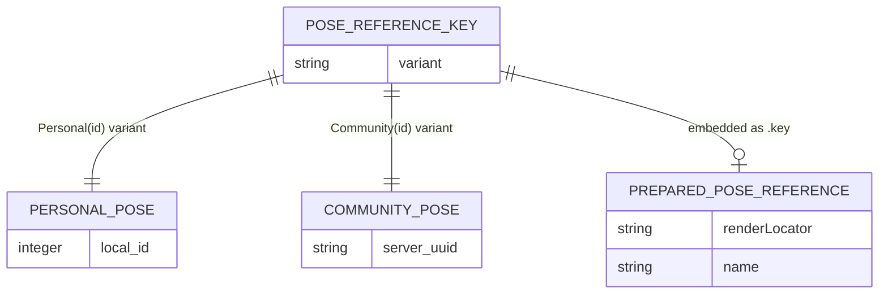
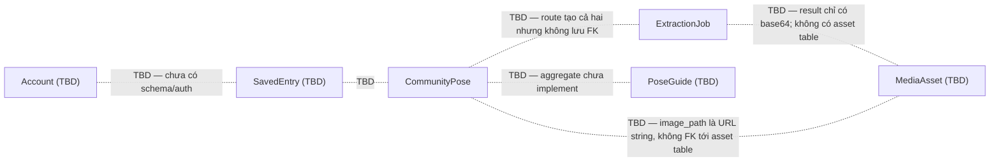

# ERD — Conceptual Overlay

Các link conceptual và unresolved giữa các entity. **Không có FK vật lý** cho các quan hệ này.

## Mobile conceptual types

## Unresolved cross-feature links (cardinality TBD)

## Bảng unresolved links

| Link | Trạng thái hiện tại |
|---|---|
| `CommunityPose` → `ExtractionJob` | Route POST tạo cả hai nhưng không lưu FK |
| `ExtractionJob` → MediaAsset | Không có asset table; result là base64 trong job |
| `CommunityPose` → render asset | `image_path` là URL string; readiness/upload chưa proven |
| `Account` → `SavedEntry` → `CommunityPose` | Không tìm thấy schema, API, hoặc auth |
| `PoseGuide` aggregate | Không có dedicated implementation |
