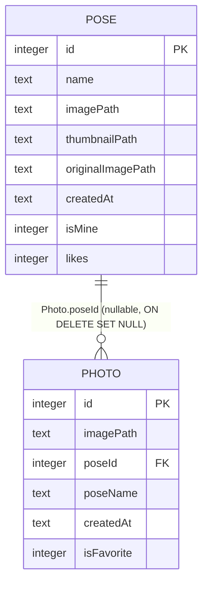

# ERD — Mobile Local Physical Graph

Source: `mobile/shared/src/commonMain/sqldelight/com/aipose/Photo.sq`, `Pose.sq`

`Photo.poseId` → `Pose.id` là FK duy nhất trong mobile schema.  
Không có FK từ mobile tables tới server tables.
