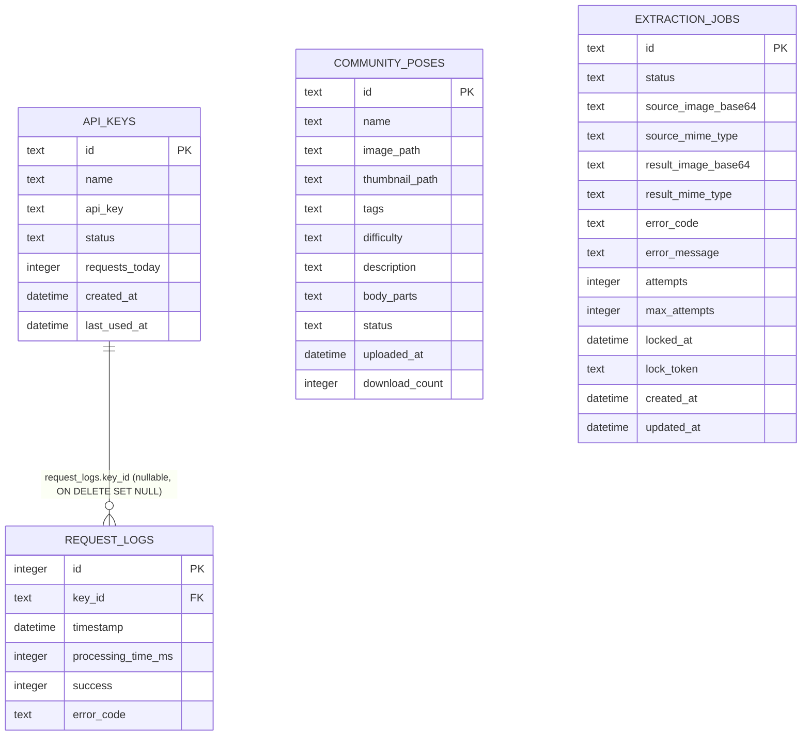

# ERD — Server Physical Graph

Source: `web/services/pose-extract-server/src/db/schema.sql`

`API_KEYS` → `REQUEST_LOGS` là FK duy nhất trong schema server.  
`COMMUNITY_POSES` và `EXTRACTION_JOBS` không có FK vật lý nào kết nối với nhau — xem [conceptual.md](conceptual.md).  
Bảng `schema_bootstrap` bị bỏ qua: operational only, không phải product entity.
