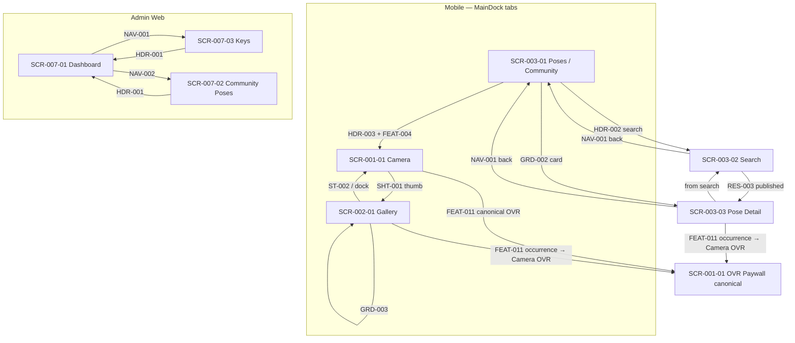

# Screens — Basic Design inventory

Presentation layer inventory cho **Basic Design** (`docs/harness/designs/basic-design/`). Chi tiết từng screen theo [canonical template](./TEMPLATE.md). Contract HTTP/DTO: [apis.md](../apis.md), [models.md](../models.md) — **không** duplicate tại đây.

| Tài liệu | Mô tả |
| --- | --- |
| [TEMPLATE.md](./TEMPLATE.md) | Khuôn chuẩn v2 cho mọi screen instance |
| [../README.md](../README.md) | Basic Design landing — scope, how-to-read, feature mapping |

## 1. Screen inventory by area

### 1.1 Mobile (`screens/mobile/`)

| Screen ID | File | Compose / Voyager | Primary feature | Doc status |
| --- | --- | --- | --- | --- |
| SCR-001-01 | [scr-001-01-camera.md](./mobile/scr-001-01-camera.md#scr-001-01-camera-camerascreen) | `CameraScreen` (`CameraTab`) | FEAT-001 | draft (template v2) |
| SCR-002-01 | [scr-002-01-gallery.md](./mobile/scr-002-01-gallery.md#scr-002-01-gallery-galleryscreen) | `GalleryScreen` + `PhotoDetailDialog` | FEAT-002 | draft (template v2) |

### 1.2 Admin Web (`screens/admin/`)

| Screen ID | File | Route / compose | Primary feature | Doc status |
| --- | --- | --- | --- | --- |
| SCR-007-01 | [scr-007-01-dashboard.md](./admin/scr-007-01-dashboard.md#scr-007-01-admin-dashboard) | `web/admin-ui/src/app/admin/page.js` | FEAT-007 | draft (template v2) |
| SCR-007-02 | [scr-007-02-community.md](./admin/scr-007-02-community.md#scr-007-02-admin-community-poses) | `.../admin/community/page.js` | FEAT-007 | draft (template v2) |
| SCR-007-03 | [scr-007-03-keys.md](./admin/scr-007-03-keys.md#scr-007-03-admin-keys) | `.../admin/keys/page.js` | FEAT-007 (+ FEAT-009 panel **Unresolved**) | draft (template v2) |

### 1.3 Legacy root (`screens/` — FEAT-003 sample slice)

| Screen ID | File | Compose / Voyager | Primary feature | Doc status |
| --- | --- | --- | --- | --- |
| SCR-003-01 | [scr-003-01-community-browse.md](./scr-003-01-community-browse.md#scr-003-01-community-browse-poseslistscreen-posesscreen) | `PosesListScreen` + `PosesScreen` | FEAT-003 | sample (template v1) |
| SCR-003-02 | [scr-003-02-search.md](./scr-003-02-search.md#scr-003-02-search-searchscreen) | `SearchScreen` | FEAT-003 | sample (template v1) |
| SCR-003-03 | [scr-003-03-pose-detail.md](./scr-003-03-pose-detail.md#scr-003-03-pose-detail-posedetailscreen) | `PoseDetailScreen` (+ Voyager wrapper) | FEAT-003 | sample (template v1) |

**Inventory count:** 8 screen files (2 mobile + 3 admin + 3 legacy root). Không gồm `TEMPLATE.md` hay file README này.

**Navigation note (FEAT-003):** `PosesListScreen` bọc `PosesScreen` và gắn `MainDock`. `PoseDetailVoyagerScreen` truyền `PosePreview` vào `PoseDetailScreen` — không thêm business logic browse/search.

## 2. Feature-to-screen mapping (FEAT-001 … FEAT-014)

| Feature | Dedicated screen(s) | Host / evidence | Ghi chú |
| --- | --- | --- | --- |
| [FEAT-001](../../../features/FEAT-001-capture-a-photo-on-mobile.md) | **Yes** — SCR-001-01 | [Camera](./mobile/scr-001-01-camera.md#scr-001-01-camera-camerascreen) | Cross-slice: FEAT-008 overlay, FEAT-011 paywall gate, FEAT-012 snapshot |
| [FEAT-002](../../../features/FEAT-002-manage-a-local-photo-gallery.md) | **Yes** — SCR-002-01 | [Gallery](./mobile/scr-002-01-gallery.md#scr-002-01-gallery-galleryscreen) | FEAT-011 paywall: **occurrence** cross-ref → [SCR-001-01 OVR](./mobile/scr-001-01-camera.md#scr-001-01-camera-ovr-paywall) only |
| [FEAT-003](../../../features/FEAT-003-browse-and-search-published-poses.md) | **Yes** — SCR-003-01/02/03 | [Browse](./scr-003-01-community-browse.md), [Search](./scr-003-02-search.md), [Detail](./scr-003-03-pose-detail.md) | **Published-leg** ownership — xem [§6](#ownership-boundary-feat-003) |
| [FEAT-004](../../../features/FEAT-004-extract-reusable-pose-images.md) | **No dedicated screen** | Entry: SCR-003-01-HDR-003 (+) → `CameraTab` — **out-of-slice** cross-ref only | Không invent screen file |
| [FEAT-005](../../../features/FEAT-005-manage-a-pose-guide.md) | **No dedicated screen** | Shared UI trên SCR-003-03 — xem [§5](#shared-occurrence-register) | Delete dialog / deleting overlay |
| [FEAT-006](../../../features/FEAT-006-publish-a-pose.md) | **No dedicated screen** | — | Policy/backend; admin status field **Observed** trên SCR-007-02, không phải owner screen |
| [FEAT-007](../../../features/FEAT-007-operate-pose-content-from-admin-web.md) | **Yes** — SCR-007-01/02/03 | [Dashboard](./admin/scr-007-01-dashboard.md), [Community](./admin/scr-007-02-community.md), [Keys](./admin/scr-007-03-keys.md) | |
| [FEAT-008](../../../features/FEAT-008-use-published-poses.md) | **No dedicated screen** | SCR-001-01 overlay; SCR-003-03 Try/Save/preparing — **out-of-slice** | Không invent screen file |
| [FEAT-009](../../../features/FEAT-009-configure-extraction-provider.md) | **No dedicated screen** | **Shared / ambiguous evidence** — [SCR-007-03 Keys](./admin/scr-007-03-keys.md#scr-007-03-admin-keys-main) Extract Engine panel (FEAT-007 primary host) | Normative semantics **Unresolved** |
| [FEAT-010](../../../features/FEAT-010-integrate-firebase-revenuecat.md) | **No dedicated screen** | Infrastructure (`App.kt`, Remote Config) — không UI surface | Không invent screen file |
| [FEAT-011](../../../features/FEAT-011-integrate-revenuecat-paid-access-and-in-app-purchases.md) | **No dedicated screen** | **Canonical OVR host/item:** [SCR-001-01](./mobile/scr-001-01-camera.md#scr-001-01-camera-ovr-paywall) (`SCR-001-01-OVR-001` … `OVR-008`). **Occurrences only:** SCR-002-01, SCR-003-03 → cross-ref Camera OVR; không invent Paywall item trên host | Không duplicate OVR item table |
| [FEAT-012](../../../features/FEAT-012-restore-pose-and-camera-settings-across-relaunch.md) | **No dedicated screen** | SCR-001-01 settings/popups/snapshot — cross-slice | Không invent screen file |
| [FEAT-013](../../../features/FEAT-013-saved-poses-albums-account-backed.md) | **No dedicated screen** | Design slice riêng: [feat-013-saved-poses](../../feat-013-saved-poses/README.md) | Proposed; runtime chưa shipped |
| [FEAT-014](../../../features/FEAT-014-manage-account-and-session.md) | **No dedicated screen** | — | Proposed; không screen evidence trong basic-design |

## 3. Status authority table

Nguồn trạng thái: [Harness inventory](../../../README.md) (bảng Features) vs frontmatter từng `FEAT-*.md`. Screen doc `status` từ frontmatter screen file.

| Feature | Harness README inventory | Feature frontmatter | Screen row(s) | Screen doc status | Ghi chú |
| --- | --- | --- | --- | --- | --- |
| FEAT-001 | Approved | approved | SCR-001-01 | draft | Android parity **Unresolved** |
| FEAT-002 | Draft | approved | SCR-002-01 | draft | **Discrepancy** inventory vs frontmatter |
| FEAT-003 | Proposed | approved | SCR-003-01/02/03 | sample | **Discrepancy** — xem [§4](#discrepancy-register) |
| FEAT-004 | Draft | approved | — (cross-ref only) | — | **Discrepancy**; no dedicated screen |
| FEAT-005 | Draft | approved | — (shared SCR-003-03) | — | **Discrepancy**; no dedicated screen |
| FEAT-006 | Draft | draft | — | — | Align |
| FEAT-007 | Draft | approved | SCR-007-01/02/03 | draft | **Discrepancy** — xem [§4](#discrepancy-register) |
| FEAT-008 | Draft | draft | — (cross-slice) | — | Align |
| FEAT-009 | Approved | approved | SCR-007-03 (shared panel) | draft | Shared/ambiguous evidence; normative semantics **Unresolved** |
| FEAT-010 | **Missing row** | approved | — | — | **Missing README inventory row** |
| FEAT-011 | **Missing row** | approved | — (OVR canonical SCR-001-01) | — | **Missing README inventory row** |
| FEAT-012 | **Missing row** | approved | — (cross-slice SCR-001-01) | — | **Missing README inventory row** |
| FEAT-013 | Proposed | proposed | — | — | Align; separate design slice |
| FEAT-014 | Proposed | proposed | — | — | Align |

## 4. Discrepancy register

| ID | Feature / area | Mô tả | Evidence |
| --- | --- | --- | --- |
| D-001 | FEAT-002 | Harness inventory **Draft** vs frontmatter **approved** | [Harness README](../../../README.md), [FEAT-002](../../../features/FEAT-002-manage-a-local-photo-gallery.md) |
| D-002 | FEAT-003 | Harness **Proposed** vs frontmatter **approved**; title search `q` **Unresolved** (mock vs live) | [apis.md#unresolved](../apis.md#unresolved), screen docs SCR-003-02 |
| D-003 | FEAT-003 | Mixed local/published search UI và local-first detail — **Observed**, không normative published-leg | [SCR-003-02](./scr-003-02-search.md), [SCR-003-03](./scr-003-03-pose-detail.md) |
| D-004 | FEAT-004 | Inventory **Draft** vs frontmatter **approved**; chỉ (+) affordance SCR-003-01-HDR-003, không screen riêng | [SCR-003-01](./scr-003-01-community-browse.md) |
| D-005 | FEAT-005 | Inventory **Draft** vs frontmatter **approved**; delete UX shared trên Pose Detail, không file screen FEAT-005 | [SCR-003-03 §7](./scr-003-03-pose-detail.md#scr-003-03-pose-detail-posedetailscreen) |
| D-006 | FEAT-007 | Inventory **Draft** vs frontmatter **approved** | Harness README vs FEAT-007 |
| D-007 | FEAT-007 / SCR-007-02 | Feature **Not observed** async polling vs code poll 60×1s | [SCR-007-02](./admin/scr-007-02-community.md) |
| D-008 | FEAT-007 / SCR-007-02 | Upload form `status` select không gửi POST; badge `local` vs options | [SCR-007-02](./admin/scr-007-02-community.md) |
| D-009 | FEAT-009 / SCR-007-03 | Feature evidence "no extraction-provider settings" vs **Observed** provider panel + API | [SCR-007-03](./admin/scr-007-03-keys.md) |
| D-010 | FEAT-011 | Roadmap claims no paywall code vs **Observed** `PaywallScreen` + gating | [SCR-001-01 §7](./mobile/scr-001-01-camera.md#scr-001-01-camera-camerascreen) |
| D-011 | FEAT-012 | Feature doc durable restore **Unresolved** vs **Observed** snapshot load/save | [SCR-001-01 §7](./mobile/scr-001-01-camera.md#scr-001-01-camera-camerascreen) |
| D-012 | FEAT-010/011/012 | Frontmatter **approved** nhưng **không có hàng** trong Harness README inventory | [Harness README](../../../README.md) |

## 5. Shared-occurrence register

Các UI/logic xuất hiện trên screen host nhưng **ownership** thuộc feature khác. Không thêm Item ID trên host khi out-of-slice (theo screen doc).

| Occurrence | Source path (code) | Owner feature | Host screen doc | Canonical / cross-ref |
| --- | --- | --- | --- | --- |
| Delete `AlertDialog` (`showDeleteDialog`) | `mobile/composeApp/.../poses/PoseDetailScreen.kt` | FEAT-005 | [SCR-003-03](./scr-003-03-pose-detail.md) | Shared — không dedicated screen |
| Preparing overlay (`DetailActionState.Preparing`) | `PoseDetailScreen.kt` | FEAT-008 | SCR-003-03 | Shared |
| Deleting overlay (`DetailActionState.Deleting`) | `PoseDetailScreen.kt` | FEAT-005 | SCR-003-03 | Shared |
| `PaywallScreen` (`showPaywall`) — **occurrence** | `PoseDetailScreen.kt` | FEAT-011 (gate); FEAT-008 (Save path) | [SCR-003-03](./scr-003-03-pose-detail.md) | **Occurrence only** → item/path [SCR-001-01-OVR-001 … OVR-008](./mobile/scr-001-01-camera.md#scr-001-01-camera-ovr-paywall); không Paywall Item ID trên SCR-003-03 |
| `PaywallScreen` (Camera tab gate) — **canonical host** | `mobile/composeApp/.../camera/CameraScreen.kt` | FEAT-011 | [SCR-001-01](./mobile/scr-001-01-camera.md#scr-001-01-camera-ovr-paywall) | **Sole canonical OVR** — định nghĩa `SCR-001-01-OVR-001` … `OVR-008` |
| `PaywallScreen` (Gallery save/share) — **occurrence** | `mobile/composeApp/.../gallery/PhotoDetailDialog.kt` | FEAT-011 | [SCR-002-01](./mobile/scr-002-01-gallery.md) | **Occurrence only** → cross-ref [SCR-001-01 OVR](./mobile/scr-001-01-camera.md#scr-001-01-camera-ovr-paywall); không Paywall Item ID trên SCR-002-01 |
| Gallery delete `AlertDialog` | `PhotoDetailDialog.kt` | FEAT-002 | SCR-002-01 | Owned by host (SCR-002-01-DLG-*) |

**Sole canonical PaywallScreen OVR (PLAN_FINAL):** Chỉ [SCR-001-01 §10 — `scr-001-01-camera-ovr-paywall`](./mobile/scr-001-01-camera.md#scr-001-01-camera-ovr-paywall) định nghĩa Paywall items (`SCR-001-01-OVR-001` … `OVR-008`). SCR-002-01 và SCR-003-03 chỉ ghi **occurrence** + cross-reference tới path/item Camera; không gọi Gallery/Pose Detail canonical; không invent Paywall item trên host đó.

## 6. Ownership boundary — FEAT-003 published-leg

Slice FEAT-003 (SCR-003-*) chỉ mô tả **published-leg**: browse catalogue, title search trên published records, và detail qua public community API. Các path **Observed / shared / out-of-slice** sau **không** thuộc acceptance hay ownership FEAT-003:

| Context | Screen | Ghi chú |
| --- | --- | --- |
| Local pose filter | SCR-003-02 | `PoseRepository` + local `Pose` — [FEAT-002](../../../features/FEAT-002-manage-a-local-photo-gallery.md) |
| Local result cards | SCR-003-02 | RES-004 — mixed UI **Observed**, không normative FEAT-003 |
| Local-first detail load | SCR-003-03 | `repository.getPoseById` trước API — navigation optimization |
| Create Pose (+) | SCR-003-01 | [FEAT-004](../../../features/FEAT-004-extract-reusable-pose-images.md) — out-of-slice |
| Try Pose / Save | SCR-003-03 | [FEAT-008](../../../features/FEAT-008-use-published-poses.md) — out-of-slice |
| Delete / preparing / paywall | SCR-003-03 | [§5 shared register](#shared-occurrence-register) |

## 7. Evidence labeling

| Label | Nguồn | Cách dùng trong Screens inventory |
| --- | --- | --- |
| **Normative** | Harness Feature + `docs/spec` | Contract hành vi/dữ liệu/API — không suy từ code |
| **Observed** | Code/read-only delivery evidence | Ghi nhận implementation hiện tại; không thay SoT |
| **Unresolved** | Conflict hoặc chưa chứng minh E2E | Status tables §3–§4, `q`/search, paywall roadmap, provider panel |

Chi tiết landing-level: [../README.md §2](../README.md#evidence-labeling).

## 8. Overall screen flow and transitions

Visual contract: [UI/UX System](../../../specs/ui-ux-system.md). FEAT-003-only subgraph chi tiết: [§9](#feat-003-flows).

## 9. Link to FEAT-003 flows

Source: [FEAT-003](../../../features/FEAT-003-browse-and-search-published-poses.md).

Harness wiki-links (raw):

- → [[FEAT-003-browse-and-search-published-poses#main-flow|FEAT-003 Main flow]] · [FEAT-003 Main flow](../../../features/FEAT-003-browse-and-search-published-poses.md#main-flow)
- → [[FEAT-003-browse-and-search-published-poses#alternative-flows|FEAT-003 Alternative A1 — Empty result]] · [FEAT-003 Alternative flows](../../../features/FEAT-003-browse-and-search-published-poses.md#alternative-flows)
- → [[FEAT-003-browse-and-search-published-poses#alternative-flows|FEAT-003 Alternative A2 — Refresh]] · [FEAT-003 Alternative flows](../../../features/FEAT-003-browse-and-search-published-poses.md#alternative-flows)
- → [[FEAT-003-browse-and-search-published-poses#exception-flows|FEAT-003 Exception E1 — Catalogue unavailable]] · [FEAT-003 Exception flows](../../../features/FEAT-003-browse-and-search-published-poses.md#exception-flows)
- → [[FEAT-003-browse-and-search-published-poses#exception-flows|FEAT-003 Exception E2 — Detail unavailable]] · [FEAT-003 Exception flows](../../../features/FEAT-003-browse-and-search-published-poses.md#exception-flows)

| Flow label | Screens | Mô tả ngắn |
| --- | --- | --- |
| Main flow | SCR-003-01 → SCR-003-03 | Browse → detail |
| Main flow (search) | SCR-003-01 → SCR-003-02 → SCR-003-03 | Search → detail |
| Alternative A1 | SCR-003-01-ST-003, SCR-003-02-ST-003 | Empty; API `200` + `data: []` |
| Alternative A2 | SCR-003-01-GRD-005 | Pull-to-refresh |
| Exception E1 | SCR-003-01-ST-002/004/005; SCR-003-02-ST-002 | Giữ confirmed results; **Observed** retry |
| Exception E2 | SCR-003-03-ST-002/003 | NotFound/Error; **return to list**; cấm stale detail |
