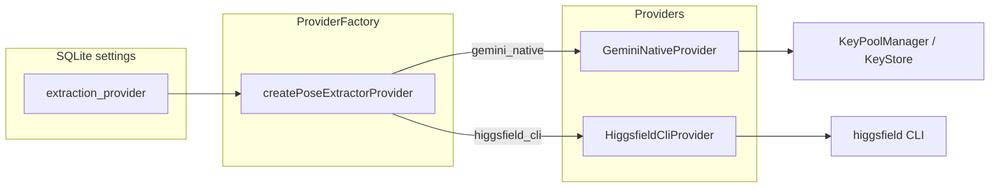
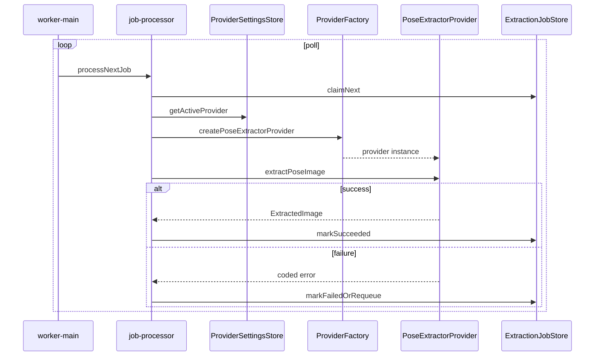
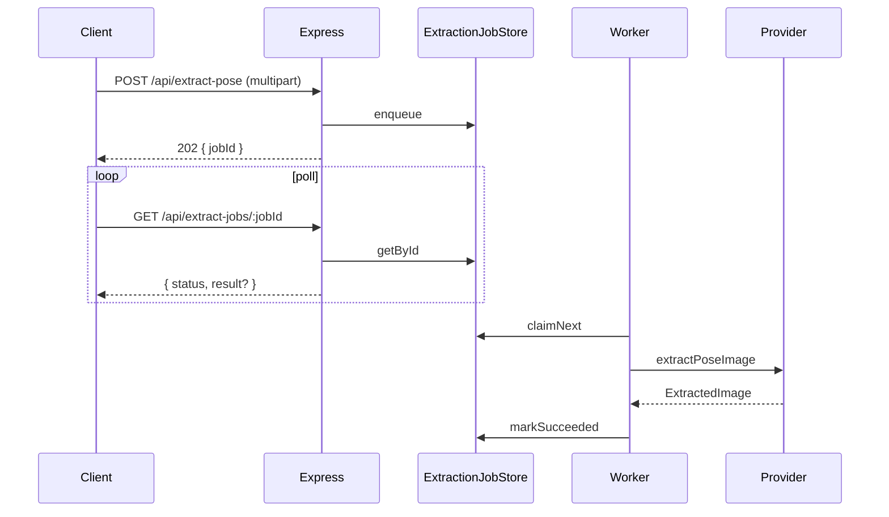
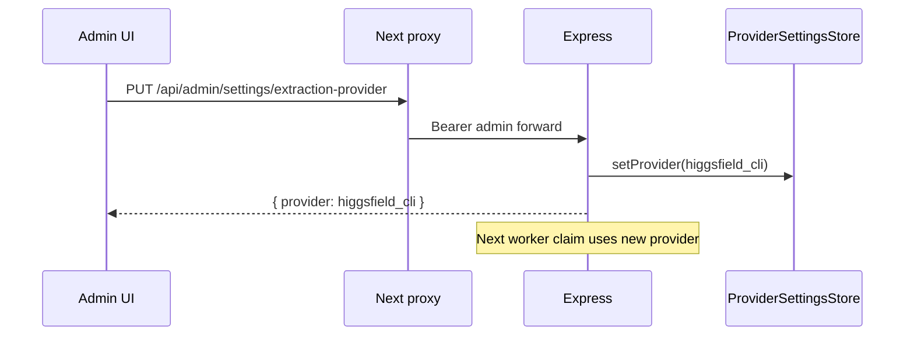
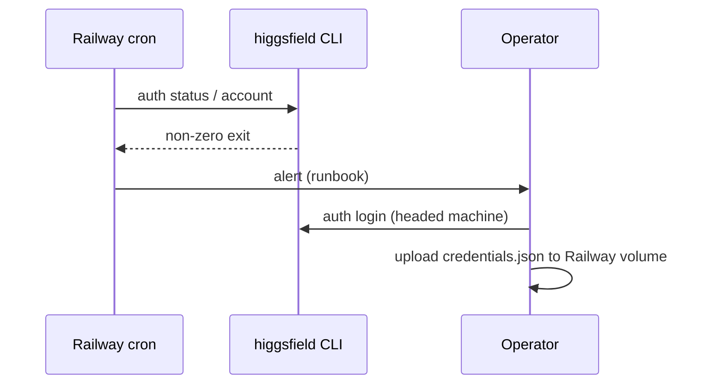

# Higgsfield CLI Parallel Extract Provider — Implementation Design

## Scope boundary

This Plan owns dual-provider pose extraction behind one `PoseExtractorProvider`
factory, async `ExtractionJob` processing for canonical extract (mobile + admin),
admin provider selection (toggle only), Docker/Railway Higgsfield CLI install and
credential layout, S1 auth health probing, and provider-neutral error codes where
the public contract must stay truthful.

Out of scope: video/UGC/Soul, MCP creative studio, mobile app code changes,
Sub2API implementation, Playwright Clerk Higgsfield login, credential-upload UI,
and synchronous `--wait` HTTP wrappers as phase 1.

## Locked architecture (do not reopen)

| # | Decision |
| --- | --- |
| 1 | `PoseExtractorProvider` factory with `GeminiNativeProvider` (REST + key pool) and `HiggsfieldCliProvider` (spawn-per-job CLI). |
| 2 | Canonical extract (mobile + admin) → `ExtractionJob` enqueue + worker poll. Provider read from SQLite by worker. |
| 3 | Admin UI: **provider toggle only**; proxy if needed. No credential-upload UI. |
| 4 | Docker installs Higgsfield CLI globally (`npm install -g`), not `npx`. Railway secret/volume for `credentials.json` / `HIGGSFIELD_CREDENTIALS_PATH`. |
| 5 | **Async jobs phase 1** (enqueue + poll). No sync `--wait` HTTP wrapper in phase 1. |
| 6 | Higgsfield **only for extract jobs**. Same `extraction_jobs` table; worker switches engine by provider. |
| 7 | Default Higgsfield model: **`kling_omni_image`** (code default in `higgsfieldCliProvider.ts`). |
| 8 | **S1 (prod):** scheduled `higgsfield auth status` / `account` probe; alert human on failure; human re-login on headed machine, upload credentials to Railway. Do **not** cron `higgsfield auth login` in headless Docker. |
| 9 | **S3 (spike, non-blocking):** writable volume + periodic CLI to test credential refresh-writes lasting >1 day. 48h evidence. Unproven — if fails, S1 stays prod path. |
| 10 | Generalize `GEMINI_*` error codes to provider-neutral codes where the API contract must stay truthful. |

## Provider interface

Reuse the Sub2API factory reference contract; each provider owns credentials.

```typescript
// web/services/pose-extract-server/src/services/poseExtractorProvider.ts
export interface PoseExtractorProvider {
  readonly id: "gemini_native" | "higgsfield_cli";

  extractPoseImage(input: {
    sourceImageBase64: string;
    sourceMimeType: string;
  }): Promise<ExtractedImage>;
}

export interface ExtractedImage {
  imageBase64: string;
  mimeType: "image/png" | "image/jpeg" | "image/webp";
}
```

Key difference from current `GeminiServiceLike`: **no `apiKey` parameter** on the
interface. `GeminiNativeProvider` wraps `KeyPoolManager` + `GeminiService`;
`HiggsfieldCliProvider` wraps CLI spawn and credential path resolution.

## Factory wiring



| Component | Responsibility |
| --- | --- |
| `ProviderSettingsStore` | Read/write `extraction_provider` (`gemini_native` \| `higgsfield_cli`) in SQLite. |
| `createPoseExtractorProvider(settings, deps)` | Instantiate the active provider for worker and (future) route handlers. |
| `GeminiNativeProvider` | Round-robin active keys, call `GeminiService.extractPoseImage`, log `ProviderRequestLog`. |
| `HiggsfieldCliProvider` | Write temp source image, spawn CLI, parse JSON, fetch result URL → base64. |

Factory reference (pattern only, not implementation target):
`web/services/pose-extract-server/plans/260510-1810-sub2api-provider-strategy-pattern/phase-01-research-interface-design.md`.

## HiggsfieldCliProvider lifecycle (spawn-per-job)

1. **Prepare input:** Decode `sourceImageBase64` to a temp file under
   `os.tmpdir()` / job-scoped directory (`/tmp/extract-jobs/<jobId>/source.png`).
2. **Spawn CLI** (no long-lived daemon):
   ```bash
   higgsfield generate create kling_omni_image \
     --image <tempPath> \
     --wait \
     --json
   ```
   Historical test fixture `higgsfield-gpt_image_2-success.json` records an earlier
   `gpt_image_2` response shape for URL-parse regression tests.
3. **Parse stdout JSON:** Extract result asset URL (exact field TBD during WI-3;
   record in implementation notes).
4. **Fetch result:** `fetch(url)` → buffer → base64; infer MIME from response
   `Content-Type` or file extension.
5. **Cleanup:** Delete temp dir in `finally`; redact URLs from logs.
6. **Timeout:** Configurable `HIGGSFIELD_CLI_TIMEOUT_MS` (default align with
   worker `BROWSER_TIMEOUT_MS` = 90s unless evidence suggests otherwise).
7. **Credentials:** Resolve from `HIGGSFIELD_CREDENTIALS_PATH` env (Railway
   volume mount) defaulting to `~/.higgsfield/credentials.json`.

Errors map to worker `error_code` values (see error table). Do not persist CLI
stdout containing secrets.

## Worker refactor

Current state (`job-processor.ts`, `worker-main.ts`): worker hardcodes
`GeminiBrowserClient` (Playwright). Target state:



- Replace `GeminiBrowserClient` dependency with `PoseExtractorProvider` from factory.
- Keep `claimNext` / `markSucceeded` / `markFailedOrRequeue` semantics unchanged.
- Playwright browser worker path is **superseded** for extract jobs when
  `gemini_native` is selected; retain code behind feature flag or remove in WI-3
  per implementation choice (default: remove browser path from extract worker to
  reduce operational coupling).
- `gemini_native` in worker uses REST provider, **not** browser automation, to
  align direct and async paths.

## Canonical extract route refactor (async phase 1)

`POST /api/extract-pose` and admin community intake both enqueue jobs and return
acceptance, not inline base64.

| Caller | Current | Target (phase 1) |
| --- | --- | --- |
| Mobile `PoseApiService.extractPose` | Sync `200` + base64 | `202` + `jobId`; client polls job status until `succeeded` (mobile change **out of Plan scope** — document contract; mobile migration is follow-on) |
| Admin community `POST .../poses` | `202` + `jobId` | Unchanged shape; worker provider follows settings |
| Direct extract route | Sync Gemini REST | `202` + `jobId` + poll URL in `Location` or body |

**Phase 1 HTTP contract (server):**

```json
// POST /api/extract-pose → 202 Accepted
{
  "success": true,
  "data": { "jobId": "<uuid>", "status": "queued" },
  "meta": { "pollUrl": "/api/admin/jobs/<uuid>" }
}
```

Public poll endpoint TBD: either extend `GET /api/admin/jobs/:jobId` with
optional rate-limited public access, or add `GET /api/extract-jobs/:jobId`
without admin secret. **Recommendation:** `GET /api/extract-jobs/:jobId` with
IP rate limit (no admin secret) for mobile; admin continues using
`/api/admin/jobs/:jobId`. Record as WI-3 implementation detail.

## Admin provider toggle API

No credential-upload UI. Admin sets provider only.

| Method | Path | Auth | Body | Response |
| --- | --- | --- | --- | --- |
| `GET` | `/api/admin/settings/extraction-provider` | Bearer admin | — | `{ data: { provider: "gemini_native" \| "higgsfield_cli" } }` |
| `PUT` | `/api/admin/settings/extraction-provider` | Bearer admin | `{ provider }` | `{ data: { provider } }` |

Admin UI (`web/admin-ui/src/app/admin/keys/page.js` or new Settings section):
radio/toggle between Gemini Native and Higgsfield CLI. Next.js proxy routes under
`web/admin-ui/src/app/api/admin/settings/` forwarding via
`poseExtractAdminServer.js`.

Default on fresh deploy: `gemini_native` (preserves current behavior path).

## Docker / Railway layout

```text
pose-extract-server container (combined API + worker)
├── node dist/index.js
├── node dist/worker/worker-main.js
├── /app/data/                    # SQLite (DATABASE_PATH)
├── /app/higgsfield/              # Railway volume mount
│   └── credentials.json          # HIGGSFIELD_CREDENTIALS_PATH
└── higgsfield (global npm bin)
```

**Dockerfile changes (WI-5):**

```dockerfile
RUN npm install -g @higgsfield/cli   # exact package name verified at implementation
ENV HIGGSFIELD_CREDENTIALS_PATH=/app/higgsfield/credentials.json
```

**Railway:**

| Secret / var | Purpose |
| --- | --- |
| `HIGGSFIELD_CREDENTIALS_PATH` | Points to mounted credentials file |
| Volume `/app/higgsfield` | Persists `credentials.json` across deploys |
| Existing `POSE_EXTRACT_ADMIN_SECRET`, `DATABASE_PATH` | Unchanged |

**S1 probe (cron sidecar or Railway cron job):**

```bash
higgsfield auth status && higgsfield account
# exit non-zero → alert (Slack/email/runbook); human re-auth on headed machine
```

Do **not** run `higgsfield auth login` in headless production.

## Error mapping table

Generalize Gemini-specific codes where the contract is provider-agnostic.

| Situation | Current code | Target code | HTTP (sync legacy) | Job `error_code` |
| --- | --- | --- | --- | --- |
| Invalid upload | `INVALID_IMAGE` | `INVALID_IMAGE` | 400 | N/A (pre-queue) |
| File too large | `IMAGE_TOO_LARGE` | `IMAGE_TOO_LARGE` | 413 | N/A |
| Rate limit | `RATE_LIMITED` | `RATE_LIMITED` | 429 | N/A |
| All keys exhausted | `ALL_KEYS_EXHAUSTED` | `ALL_KEYS_EXHAUSTED` | 503 | `PROVIDER_CREDENTIALS_EXHAUSTED` |
| Provider quota | `GEMINI_QUOTA_EXCEEDED` | `PROVIDER_QUOTA_EXCEEDED` | 429 | `PROVIDER_QUOTA_EXCEEDED` |
| Provider failure | `GEMINI_ERROR` | `PROVIDER_ERROR` | 500 | `PROVIDER_ERROR` |
| Higgsfield auth | — | `PROVIDER_AUTH_REQUIRED` | — | `PROVIDER_AUTH_REQUIRED` |
| Higgsfield CLI timeout | — | `PROVIDER_TIMEOUT` | — | `PROVIDER_TIMEOUT` |
| Higgsfield CLI spawn fail | — | `PROVIDER_CLI_FAILED` | — | `PROVIDER_CLI_FAILED` |
| Browser auth (legacy worker) | `BROWSER_AUTH_REQUIRED` | Deprecate with browser path | — | — |

Keep `GEMINI_*` as aliases in responses for one release if needed; document
deprecation in `docs/harness/specs/api-contract.md#extract-pose` during WI-1/WI-7.

## Sequence flows

### A — Mobile/admin extract (async phase 1)



### B — Admin switches provider



### C — S1 auth probe failure



## SQLite schema addition

```sql
CREATE TABLE IF NOT EXISTS app_settings (
  key TEXT PRIMARY KEY,
  value TEXT NOT NULL,
  updated_at DATETIME NOT NULL DEFAULT CURRENT_TIMESTAMP
);
-- seed: INSERT OR IGNORE INTO app_settings (key, value) VALUES ('extraction_provider', 'gemini_native');
```

Optional: add `provider TEXT` column on `extraction_jobs` to record which engine
processed the job (audit); not required for routing if settings are global.

## Testing strategy (WI-7)

- Unit: `HiggsfieldCliProvider` with mocked `child_process.spawn` and `fetch`.
- Unit: `ProviderFactory` selection from settings.
- Integration: enqueue → worker mock provider → job `succeeded`.
- Contract: error code mapping table assertions in `extractPose.test.ts` and
  job status routes.
- Manual: S1 probe script dry-run; S3 48h volume evidence (WI-6).
