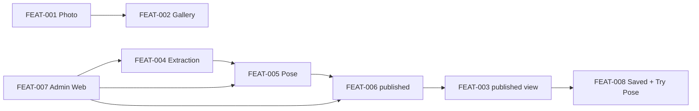
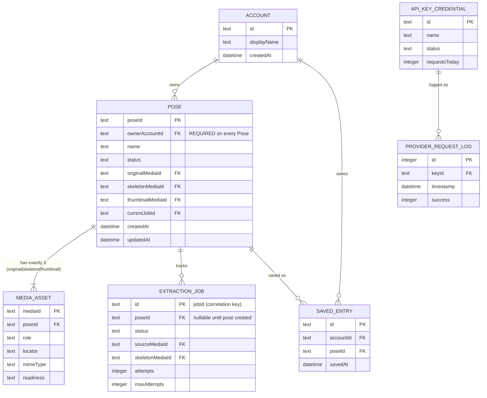
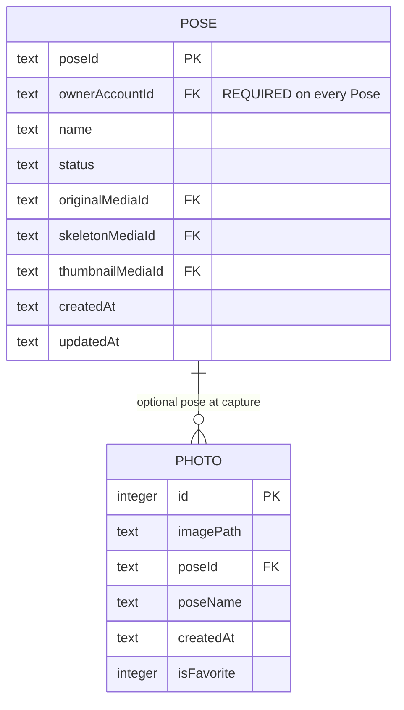
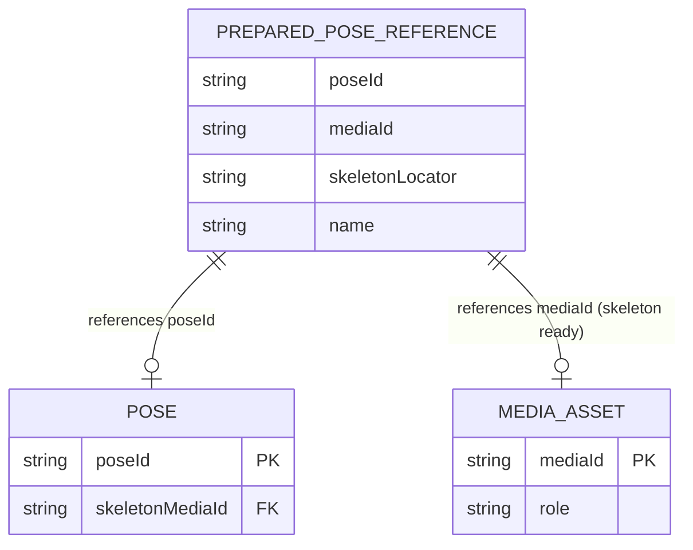
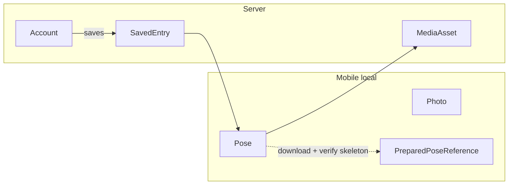

# Data Contract

Single source of truth cho **mô hình dữ liệu product** của ai-pose: domain model,
entities, enums, và ERD. Tên entity / field / enum tiếng Anh; mô tả tiếng Việt.

Hợp đồng mô tả dữ liệu **mà Features yêu cầu**, không mô tả schema runtime.
Thuật ngữ chuẩn: [`pose-domain-glossary.md`](./pose-domain-glossary.md)
(ID strategy + terminology migration map). HTTP contract:
[`api-contract.md`](./api-contract.md).

## Domain model

### Hai layer, không đồng bộ

| Layer | Thực thể | Ý nghĩa |
|---|---|---|
| Mobile local | `Photo`, `Pose` | Ảnh chụp sống trên thiết bị; `Pose` local được tạo **sau khi extraction `succeeded`** (`status = local`) và cùng `poseId` với server. Không có FK bắt buộc tới server. |
| Server | `Pose`, `MediaAsset`, `ExtractionJob`, `Account`, `SavedEntry`, `ApiKeyCredential`, `ProviderRequestLog` | Entity canonical, media, job, identity, saved collection, vận hành provider. |
| Mobile conceptual | `PreparedPoseReference` | Hợp đồng in-memory tạm cho Try Pose. Không persist qua relaunch. |

Không còn entity song song `PoseGuide`, `PersonalPose`, `CommunityPose`. `Pose` là
entity canonical duy nhất; catalogue công khai là view/DTO lọc `status = published`.

### Luồng product

1. Photographer chụp `Photo` (FEAT-001) và quản lý gallery local (FEAT-002).
2. Một ảnh nguồn (`original`) đi qua extraction (FEAT-004): submit enqueue
   `ExtractionJob` (`202` + `jobId`), poll tới `succeeded`; **chưa có `Pose`**.
3. Khi extraction thành công, `Pose` được tạo (FEAT-005): `poseId` (UUID) ổn định,
   `status = local`, và cả ba `MediaAsset` (`original`, `skeleton`, `thumbnail`)
   materialize ngay; sau đó Pose Owner quản lý metadata, retry, re-extract,
   revert, xóa.
4. Pose Owner publish khi pose đủ điều kiện: có `MediaAsset` skeleton `ready` và
   đủ thẩm quyền (FEAT-006).
5. Visitor/user duyệt catalogue published (view `Pose.status = published`), lọc,
   tìm theo title (FEAT-003).
6. Signed-in user lưu `SavedEntry` và chuẩn bị Try Pose (FEAT-008). Use không cấp
   quyền sở hữu.
7. Admin Web (FEAT-007) vận hành cùng các hợp đồng trên; không định nghĩa model
   extraction/publication riêng.

### Ranh giới quan trọng

- `Photo` không bắt buộc sync lên server; `Pose` local cùng `poseId` với server.
- **Không có `Pose` persisted trước khi extraction thành công.** Trong lúc
  extraction chỉ tồn tại `ExtractionJob` với `jobId` (correlation key); pose được
  tạo sau `succeeded`.
- `ownerAccountId` bắt buộc trên mọi `Pose`; authenticated actor (Admin Bearer)
  có thể khác owner trong API headers.
- `published` chỉ hợp lệ khi skeleton asset `ready` — không đồng nghĩa với "đã
  enqueue job".
- `SavedEntry` theo dõi sử dụng cá nhân; unpublish/xóa pose phải ngừng trình bày
  pose đó như nội dung công khai.
- `ApiKeyCredential` / `ProviderRequestLog` là vận hành provider, không phải catalog product.

## Entities

### Photo

Ảnh still do Photographer chụp trên mobile, lưu local. Bản ghi trung tâm của
FEAT-001 (capture) và FEAT-002 (gallery). Không có HTTP API. Vì `Pose` chỉ được
tạo sau khi extraction `succeeded`, `Photo.poseId` chỉ tồn tại khi pose đã tạo.

| Field | Type | Required | Description |
|---|---|---|---|
| `id` | INTEGER | PK | Local unique ID |
| `imagePath` | TEXT | ✓ | Đường dẫn file local đọc được |
| `poseId` | TEXT (UUID) | — | Optional FK tới canonical `Pose` tại thời điểm chụp |
| `poseName` | TEXT | ✓ (default `''`) | Snapshot tên pose lúc chụp |
| `createdAt` | TEXT | ✓ | ISO 8601 |
| `isFavorite` | INTEGER | ✓ (default `0`) | `0` false, `1` true |

- `Photo.poseId` → `Pose.poseId` (optional, ON DELETE SET NULL; type UUID)
- Không FK bắt buộc tới entity server

| ID | Rule |
|---|---|
| BR-PHOTO-001 | Một capture được chấp nhận tạo đúng một `Photo` và một file ảnh đọc được. Thiếu một trong hai thì không được báo thành công. |
| BR-PHOTO-002 | Capture bị tắt cho đến khi camera permission được cấp. |
| BR-PHOTO-003 | Xóa photo chỉ hoàn tất khi metadata và file thuộc sở hữu đều đã gỡ. |
| BR-PHOTO-004 | Favorite, delete, export chỉ hiện success sau khi hành động đã xác nhận. |
| BR-PHOTO-005 | Metadata trỏ file không đọc được thì UI placeholder + recovery; không crash. |
| BR-PHOTO-006 | Xóa `Pose` không xóa `Photo`; `poseId` SET NULL. `poseName` là snapshot. |

### Pose

Entity trung tâm và **duy nhất** của domain product: một pose dùng lại được, với
`poseId` UUID ổn định từ lúc tạo tới `published`. Khối làm việc của Pose Owner
(FEAT-005) và đối tượng trên catalogue công khai khi `status = published`.

**Creation timing:** `Pose` được tạo **chỉ sau khi extraction `succeeded`**
(`202` + `jobId` là job start — chưa có Pose; `201` là pose creation). Lúc tạo,
cả ba `MediaAsset` (`original`, `skeleton`, `thumbnail`) materialize ngay,
non-nullable. `ownerAccountId` **bắt buộc** trên mọi `Pose` (mobile + admin);
authenticated actor có thể khác owner trong API headers (Admin Bearer phải kèm
`ownerAccountId` tường minh).

| Field | Type | Required | Description |
|---|---|---|---|
| `poseId` | TEXT (UUID) | PK | Định danh duy nhất, gán một lần tại lúc tạo (post-extraction), ổn định `local` → `published` |
| `ownerAccountId` | TEXT (UUID) | ✓ | `Account` sở hữu pose — bắt buộc trên mọi Pose |
| `name` | TEXT | ✓ | Tên hiển thị |
| `description` | TEXT | — | Mô tả |
| `tags` | TEXT[] | ✓ (default `[]`) | Nhãn lọc catalogue |
| `difficulty` | TEXT | — | Enum `PoseDifficulty` |
| `bodyParts` | TEXT[] | ✓ | Ít nhất một phần cơ thể |
| `status` | TEXT | ✓ (default `local`) | Enum `PoseStatus`: `local` \| `published` |
| `originalMediaId` | TEXT (UUID) | ✓ | `MediaAsset` role `original` — materialize tại lúc tạo |
| `skeletonMediaId` | TEXT (UUID) | ✓ | `MediaAsset` role `skeleton` — materialize tại lúc tạo; bắt buộc `ready` trước publish |
| `thumbnailMediaId` | TEXT (UUID) | ✓ | `MediaAsset` role `thumbnail` — materialize tại lúc tạo |
| `currentJobId` | TEXT (UUID) | — | `ExtractionJob` đã tạo skeleton hiện tại |
| `createdAt` | DATETIME | ✓ | Thời điểm tạo (sau extraction success) |
| `updatedAt` | DATETIME | ✓ | Thời điểm cập nhật cuối |

> API response (`PoseResponse`) thay ba media id bằng URL camelCase:
> `originalUrl`, `skeletonUrl`, `thumbnailUrl` + `poseId`, `ownerAccountId`, `currentJobId`.

- `Pose.ownerAccountId` → `Account.id` (bắt buộc)
- `Pose` 1 — 3 `MediaAsset` (roles `original`, `skeleton`, `thumbnail`), non-nullable
- `Pose` 1 — 0..* `ExtractionJob` (lịch sử; `currentJobId` trỏ job hiện tại)
- `Pose` 1 — 0..* `SavedEntry` (`poseId`) khi `published`
- `Photo.poseId` → `Pose.poseId` (optional, mobile local)
- Public catalogue = view lọc `Pose.status = published` (DTO `CommunityPose`)

| ID | Rule |
|---|---|
| BR-POSE-001 | Submit ảnh hợp lệ chỉ enqueue `ExtractionJob` (`202` + `jobId`) — không tạo `Pose`. `Pose` tạo chỉ sau khi extraction `succeeded` (`201`). |
| BR-POSE-002 | Không tuyên bố pose public khi skeleton `MediaAsset` chưa `ready`. |
| BR-POSE-003 | Retry / re-extract tạo hoặc tái xếp `ExtractionJob` gắn cùng `Pose`; không tạo pose mới. |
| BR-POSE-004 | `poseId` gán một lần tại tạo và giữ nguyên khi `local` → `published`; publish không tạo entity thứ hai. |
| BR-POSE-005 | Xóa terminal gỡ pose khỏi catalogue, ngắt `SavedEntry` khỏi nội dung công khai. |
| BR-POSE-006 | Chỉ owner `Account` hoặc Admin operator được sửa metadata, retry, re-extract, revert, xóa. |
| BR-POSE-007 | Catalogue công khai chỉ trả `status = published`; đây là view/DTO. |
| BR-POSE-008 | `ownerAccountId` bắt buộc trên mọi `Pose`; pose do Admin tạo phải chỉ định owner. |
| BR-POSE-009 | Đúng ba `MediaAsset` materialize tại lúc tạo pose; ba slot non-nullable từ creation. |

### MediaAsset

Payload media gắn với một `Pose`. Mỗi `Pose` có đúng **ba** media role:
`original` (nguồn), `skeleton` (kết quả extraction), `thumbnail` (thu nhỏ).
**Cả ba được materialize ngay tại lúc tạo pose (post-extraction)**, và cả ba slot
của `Pose` đều non-nullable.

| Field | Type | Required | Description |
|---|---|---|---|
| `mediaId` | TEXT (UUID) | PK | Định danh asset |
| `poseId` | TEXT (UUID) | ✓ | `Pose` sở hữu asset |
| `role` | TEXT | ✓ | Enum `MediaAssetRole`: `original` \| `skeleton` \| `thumbnail` |
| `locator` | TEXT | ✓ | URI đọc được (object storage hoặc tương đương) |
| `mimeType` | TEXT | ✓ | `image/png`, `image/jpeg`, hoặc `image/webp` |
| `readiness` | TEXT | ✓ | Enum `MediaAssetReadiness`: `pending` \| `ready` \| `failed` |
| `createdAt` | DATETIME | ✓ | Thời điểm tạo |
| `updatedAt` | DATETIME | ✓ | Thời điểm cập nhật cuối |

- Mỗi `Pose` có đúng một asset mỗi role (`originalMediaId`/`skeletonMediaId`/`thumbnailMediaId` → `MediaAsset.mediaId`)
- `ExtractionJob` thành công cập nhật hoặc tạo `MediaAsset` role `skeleton` thành `ready`
- Public DTO (`Pose` published) trả `skeleton` / `thumbnail` `ready`

| ID | Rule |
|---|---|
| BR-ASSET-001 | Mỗi `Pose` có đúng một `original` hiện hành. |
| BR-ASSET-002 | Publish chỉ được khi tồn tại `skeleton` `readiness = ready` và `locator` đọc được. |
| BR-ASSET-003 | `pending` hoặc `failed` không được dùng làm ảnh catalogue hay Try Pose. |
| BR-ASSET-004 | Locator công khai của `Pose` published phải trỏ asset `ready`, không trỏ payload tạm trên job. |
| BR-ASSET-005 | Đúng ba `MediaAsset` materialize tại lúc tạo pose; ba slot non-nullable. |

### ExtractionJob

Job theo dõi một lần extraction ảnh pose (FEAT-004). **`id` của job chính là
`jobId`** — correlation key trong lúc extraction: submit enqueue và trả `202` +
`jobId` mà **chưa có `Pose`**. Khi job `succeeded`, hệ thống tạo `Pose` (stable
`poseId`), materialize ba `MediaAsset`, và back-fill `poseId` của job.

| Field | Type | Required | Description |
|---|---|---|---|
| `id` | TEXT (UUID) | PK | `jobId` — server-generated UUID; correlation key khi pose chưa tồn tại |
| `poseId` | TEXT (UUID) | — | `Pose` khi job thuộc pose flow; NULL tới khi extraction `succeeded` và `Pose` tạo |
| `status` | TEXT | ✓ | Enum `ExtractionJobStatus` |
| `sourceMediaId` | TEXT (UUID) | — | `MediaAsset` original khi có pose |
| `skeletonMediaId` | TEXT (UUID) | — | `MediaAsset` skeleton khi `succeeded` |
| `errorCode` | TEXT | — | Khi `failed` |
| `errorMessage` | TEXT | — | Khi `failed` |
| `attempts` | INTEGER | ✓ (default `0`) | Số lần đã thử |
| `maxAttempts` | INTEGER | ✓ (default `3`) | Trần retry |
| `createdAt` | DATETIME | ✓ | Enqueue |
| `updatedAt` | DATETIME | ✓ | Cập nhật cuối |

- Nhiều `ExtractionJob` → một `Pose` (`poseId`, nullable tới khi pose tạo)
- Job `succeeded` → tạo `Pose` + materialize ba `MediaAsset`; cập nhật `skeletonMediaId`
- Dùng `ApiKeyCredential` gián tiếp qua FEAT-004; mỗi attempt ghi `ProviderRequestLog`

| ID | Rule |
|---|---|
| BR-JOB-001 | Trạng thái quan sát được: `queued`, `processing`, `succeeded`, `failed`. |
| BR-JOB-002 | Còn lượt `attempts < maxAttempts` thì failure được requeue; hết lượt thì `failed`. |
| BR-JOB-003 | `succeeded` mà chưa có `MediaAsset` skeleton `ready` thì pose chưa đủ điều kiện publish. |
| BR-JOB-004 | `GET` job: `result` chỉ khi `succeeded`; `error` chỉ khi `failed`. |
| BR-JOB-005 | Không tuyên bố usable image khi provider thất bại hoặc job chưa `succeeded`. |
| BR-JOB-006 | Không tồn tại `Pose` persisted trước khi job `succeeded`; `Pose` được tạo sau `succeeded`. |

### CommunityPose (deprecated as entity — public DTO/view)

> **Deprecated as entity.** `CommunityPose` không còn là entity lưu trữ riêng.
> Nó là **DTO / filtered view** đọc kết quả trên canonical `Pose` với
> `status = published`. Không có bảng/entity `CommunityPose` độc lập.
> Catalogue (FEAT-003) chỉ đọc view này; visibility do FEAT-006 quyết định qua
> `Pose.status`. Cùng `poseId` với `Pose` nguồn; **không lộ `ownerAccountId`,
> `originalUrl`, hay job**.

| Field (DTO) | Type | Required | Description |
|---|---|---|---|
| `poseId` | TEXT (UUID) | PK | `Pose.poseId` |
| `name` | TEXT | ✓ | Tên pose |
| `skeletonUrl` | TEXT | ✓ | Locator skeleton `ready` |
| `thumbnailUrl` | TEXT | ✓ | Locator thumbnail `ready` — non-nullable |
| `tags` | TEXT[] | ✓ | Nhãn |
| `difficulty` | TEXT | — | Enum `PoseDifficulty` |
| `description` | TEXT | — | Mô tả |
| `bodyParts` | TEXT[] | ✓ | Phần cơ thể |
| `status` | TEXT | ✓ | Luôn `published` trên public API |
| `uploadedAt` | DATETIME | ✓ | Thời điểm pose vào catalogue |
| `downloadCount` | INTEGER | ✓ (default `0`) | Tăng khi GET detail thành công |

| ID | Rule |
|---|---|
| BR-COMMUNITY-001 | Public list/detail chỉ trả `status = published`. |
| BR-COMMUNITY-002 | `downloadCount` tăng 1 mỗi lần `GET /api/community/poses/:id` thành công. |
| BR-COMMUNITY-003 | Admin đọc canonical `Pose` (cả local và published); DTO chỉ đại diện `published`. |
| BR-COMMUNITY-004 | `skeletonUrl` phải là locator skeleton `ready`. |
| BR-COMMUNITY-005 | Title search (`q`) chỉ khớp trên published records. |
| BR-COMMUNITY-006 | Filter `tag`/`difficulty` áp trên published list; kết quả không trùng `poseId` active. |
| BR-COMMUNITY-007 | Là view/DTO; không có storage riêng. |
| BR-COMMUNITY-008 | DTO published-only: `status` luôn `published`. |

### Account

Identity của người dùng đã đăng nhập. Dùng cho quyền sở hữu `Pose` (FEAT-005,
FEAT-006) và collection `SavedEntry` (FEAT-008). Admin operator không phải
`Account` (dùng Bearer admin secret), nhưng mọi `Pose` — kể cả pose Admin tạo —
vẫn có `ownerAccountId` bắt buộc (Admin phải chỉ định owner tường minh).

| Field | Type | Required | Description |
|---|---|---|---|
| `id` | TEXT (UUID) | PK | Định danh account |
| `displayName` | TEXT | ✓ | Tên hiển thị |
| `createdAt` | DATETIME | ✓ | Thời điểm tạo |

- Một `Account` 1 — 0..* `Pose` (owner)
- Một `Account` 1 — 0..* `SavedEntry`

| ID | Rule |
|---|---|
| BR-ACCOUNT-001 | Chỉ signed-in `Account` được Save / Unsave và sở hữu pose. |
| BR-ACCOUNT-002 | Dùng published pose không cấp quyền owner hay publish. |
| BR-ACCOUNT-003 | Publish / unpublish đòi hỏi owner `Account` hoặc Admin operator. |
| BR-ACCOUNT-004 | Visitor chọn hành động cần account thì yêu cầu đăng nhập; không xác nhận Saved khi chưa có `Account`. |
| BR-ACCOUNT-005 | `ownerAccountId` bắt buộc (non-nullable) trên mọi `Pose`; pose Admin tạo phải kèm owner tường minh. |

### SavedEntry

Bản ghi "đã lưu" giữa một signed-in `Account` và một pose `published` (FEAT-008).
Không cấp ownership; không tạo entity pose riêng.

| Field | Type | Required | Description |
|---|---|---|---|
| `id` | TEXT (UUID) | PK | Định danh entry |
| `accountId` | TEXT (UUID) | ✓ | `Account` đã lưu |
| `poseId` | TEXT (UUID) | ✓ | `Pose` id (phải `published`) |
| `savedAt` | DATETIME | ✓ | Thời điểm lưu |

- Nhiều `SavedEntry` → một `Account`
- Nhiều `SavedEntry` → một `Pose` (`poseId`)
- Unique (`accountId`, `poseId`)

| ID | Rule |
|---|---|
| BR-SAVED-001 | Chỉ lưu pose đang `published`. Lưu draft/local bị từ chối. |
| BR-SAVED-002 | Unique một entry cho mỗi cặp account + pose. Lưu lại là idempotent. |
| BR-SAVED-003 | Unsave xóa entry; không đụng pose hay catalogue. |
| BR-SAVED-004 | Khi pose unpublish/xóa, Saved collection không trình bày pose như nội dung công khai còn hiệu lực. |
| BR-SAVED-005 | Use / Save không cấp quyền sửa, publish, hay xóa pose. |

### ApiKeyCredential

Provider API key dùng cho extraction (FEAT-004). Admin quản lý trên Admin Web
(FEAT-007). Secret không bao giờ trả về client.

| Field | Type | Required | Description |
|---|---|---|---|
| `id` | TEXT (UUID) | PK | Server-generated UUID |
| `name` | TEXT | ✓ | Label |
| `apiKey` | TEXT | ✓ | Secret; omit mọi response |
| `status` | TEXT | ✓ (default `active`) | Enum `ApiKeyStatus` |
| `requestsToday` | INTEGER | ✓ (default `0`) | Đếm trong ngày |
| `createdAt` | DATETIME | ✓ | Thời điểm tạo |
| `lastUsedAt` | DATETIME | — | Lần dùng cuối |

- Một `ApiKeyCredential` 1 — 0..* `ProviderRequestLog` (`keyId`, ON DELETE SET NULL)

| ID | Rule |
|---|---|
| BR-KEY-001 | Secret `apiKey` không xuất hiện trên bất kỳ API response nào. |
| BR-KEY-002 | Key `exhausted` được reset định kỳ về `active`, `requestsToday = 0`. |
| BR-KEY-003 | Extraction chọn key `active`; hết quota thì đánh `exhausted` và xoay key còn lại. |
| BR-KEY-004 | Hết key `active` thì extraction thất bại có thể phục hồi. |
| BR-KEY-005 | Status phải là `active`, `disabled`, hoặc `exhausted`. |

### ProviderRequestLog

Log một lần gọi provider trong extraction (FEAT-004). Dùng cho chẩn đoán và
giám sát usage.

| Field | Type | Required | Description |
|---|---|---|---|
| `id` | INTEGER | PK | Sequential log ID |
| `keyId` | TEXT | — | `ApiKeyCredential`; NULL nếu key đã xóa |
| `timestamp` | DATETIME | ✓ | Thời điểm ghi |
| `processingTimeMs` | INTEGER | — | Thời gian xử lý |
| `success` | INTEGER | ✓ | `1` thành công, `0` thất bại |
| `errorCode` | TEXT | — | Khi thất bại |

- Nhiều log → một `ApiKeyCredential` (nullable, ON DELETE SET NULL)

| ID | Rule |
|---|---|
| BR-LOG-001 | Mọi attempt extraction (thành công hoặc thất bại) đều ghi một log. |
| BR-LOG-002 | `keyId` NULL khi không gắn được key hoặc key đã xóa. |

### PreparedPoseReference

Hợp đồng transport trên mobile khi Try Pose thành công (FEAT-008). Xác nhận
skeleton đã sẵn sàng trước khi rời detail vào Camera. Không persist qua relaunch.
Dùng ID đơn giản `poseId` (UUID) + `mediaId` (UUID); không còn
`PoseReferenceKey.Personal|Community`.

| Field | Type | Required | Description |
|---|---|---|---|
| `poseId` | String (UUID) | ✓ | Identity canonical `Pose` đã chọn |
| `mediaId` | String (UUID) | ✓ | `MediaAsset.mediaId` của skeleton |
| `name` | String | ✓ | Tên hiển thị |
| `skeletonLocator` | String | ✓ | Skeleton đã verify: data URI hoặc absolute local path. Không bao giờ remote URL. |

- `poseId` → `Pose.poseId`; `mediaId` → `MediaAsset.mediaId` role `skeleton` `ready`

| ID | Rule |
|---|---|
| BR-PREPREF-001 | `skeletonLocator` chỉ local/data URI sau bước prepare. |
| BR-PREPREF-002 | Không persist qua relaunch. Chọn pose khác thì thay reference in-memory. |
| BR-PREPREF-003 | Verify ảnh phải pass trước khi emit; thất bại thì ở lại detail. |
| BR-PREPREF-004 | Try Pose không cấp ownership hay quyền publish. |

## Deprecated entities (giữ wikilink + migration)

### PoseGuide (deprecated alias of Pose)

> **Deprecated.** `PoseGuide` là tên cũ của aggregate canonical `Pose`. Toàn bộ
> semantics, fields, business rules đã chuyển sang `Pose`. Mọi tham chiếu về sau
> dùng `Pose`; mục này giữ để duy trì wikilink và ghi nhận quá trình migrate.

| `PoseGuide` cũ | `Pose` mới |
|---|---|
| `id` | `poseId` (UUID) |
| `sourceAssetId` | `originalMediaId` |
| `renderAssetId` | `skeletonMediaId` |
| `thumbnailAssetId` | `thumbnailMediaId` |
| `status` (`draft`\|`published`) | `status` (`local`\|`published`) |

### PersonalPose (deprecated — folded into Pose)

> **Deprecated as entity.** Khái niệm pose cá nhân hợp nhất vào `Pose` với
> `poseId` (UUID) ổn định. Nay pose local dùng `Pose` với `status = local`.

| `PersonalPose` cũ | `Pose` mới |
|---|---|
| `id` (INTEGER local) | `poseId` (UUID) |
| `imagePath` (local render) | `skeletonMediaId` → `MediaAsset` role `skeleton` |
| `thumbnailPath` | `thumbnailMediaId` |
| `originalImagePath` | `originalMediaId` |

### PoseReferenceKey (deprecated)

> **Deprecated.** Union cũ Personal-vs-Community trên mobile (ID số local cho
> `PersonalPose`, UUID server cho `CommunityPose`). Đã bị gỡ khỏi canonical model;
> replaced bằng `poseId` (UUID) + `mediaId` (UUID) — xem glossary.

| `PoseReferenceKey` cũ | Canonical mới |
|---|---|
| `Personal.id` (Long) | `poseId` (UUID) |
| `Community.id` (String) | `poseId` (UUID) — cùng namespace |
| Embed trong `PreparedPoseReference.key` | `PreparedPoseReference.poseId` + `mediaId` |

## Enums

### PoseStatus

| Giá trị | Ý nghĩa |
|---|---|
| `local` | Chưa public; chỉ owner và Admin thấy. Trạng thái khởi tạo (post-extraction) |
| `published` | Trên public catalogue; list/detail công khai chỉ trả trạng thái này |

> `draft` (legacy) là alias deprecated của `local`. Publish đòi hỏi skeleton
> `MediaAsset` `ready` (BR-POSE-002, BR-ASSET-002).

### PoseDifficulty

| Giá trị | Ý nghĩa |
|---|---|
| `beginner` | Người mới |
| `intermediate` | Trung bình |
| `advanced` | Nâng cao |
| _(null)_ | Không gán độ khó |

### MediaAssetRole

`Pose` có đúng ba media role, materialize tại lúc tạo pose, non-nullable:

| Giá trị | Ý nghĩa |
|---|---|
| `original` | Ảnh nguồn đưa vào extraction (trước đây gọi `source`) |
| `skeleton` | Kết quả extraction dùng lại được (trước đây gọi `render`) |
| `thumbnail` | Ảnh thu nhỏ cho catalogue |

### MediaAssetReadiness

| Giá trị | Ý nghĩa |
|---|---|
| `pending` | Chưa có locator đọc được |
| `ready` | Locator đọc được; đủ cho catalogue / Try Pose / publish (role `skeleton`) |
| `failed` | Không dùng được; không publish, không Try Pose |

### ExtractionJobStatus

| Giá trị | Ý nghĩa |
|---|---|
| `queued` | Chờ xử lý |
| `processing` | Đang extraction |
| `succeeded` | Có kết quả; skeleton asset phải `ready` trước khi publish |
| `failed` | Hết `maxAttempts` hoặc lỗi không retry |

### ApiKeyStatus

| Giá trị | Ý nghĩa |
|---|---|
| `active` | Được chọn cho extraction |
| `disabled` | Tắt thủ công |
| `exhausted` | Hết quota ngày; reset về `active` |

## ERD

### Server

Entity canonical duy nhất là `Pose`; catalogue công khai là view/DTO
(`status=published`), không phải entity riêng.

### Mobile local

`Pose` local dùng canonical entity với `status = local`, tạo **sau khi extraction
`succeeded`**. `Photo.poseId` → `Pose.poseId` optional (UUID), ON DELETE SET NULL.

### Conceptual overlay

Try Pose (in-memory) + ranh giới layer (FEAT-008).

