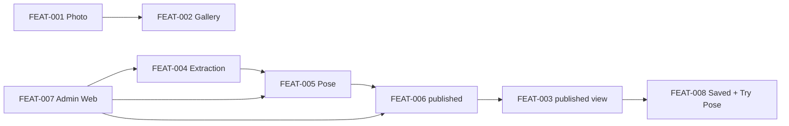

# Domain Model

Mô hình dữ liệu product mà [FEAT-001](../../harness/features/FEAT-001-capture-a-photo-on-mobile.md)–[FEAT-008](../../harness/features/FEAT-008-use-published-poses.md) yêu cầu.

Canonical glossary thuật ngữ: [`../../../harness/specs/pose-domain-glossary.md`](../../harness/specs/pose-domain-glossary.md).

## Hai layer, không đồng bộ

| Layer | Thực thể | Ý nghĩa |
|---|---|---|
| Mobile local | `Photo`, `Pose` | Ảnh chụp sống trên thiết bị; `Pose` local được tạo **sau khi extraction `succeeded`** (`status = local`) và cùng `poseId` với server. Không có FK bắt buộc tới server. |
| Server | `Pose`, `MediaAsset`, `ExtractionJob`, `Account`, `SavedEntry`, `ApiKeyCredential`, `ProviderRequestLog` | Entity canonical, media, job, identity, saved collection, vận hành provider. |
| Mobile conceptual | `PreparedPoseReference` | Hợp đồng in-memory tạm cho Try Pose. Không persist qua relaunch. |

Không còn entity song song `PoseGuide`, `PersonalPose`, `CommunityPose`. `Pose` là
entity canonical duy nhất; catalogue công khai là view/DTO lọc `status = published`.

## Entity trung tâm: Pose

`Pose` ([`entities/pose.md`](entities/pose.md)) là đơn vị làm việc của Pose Owner
([FEAT-005](../../harness/features/FEAT-005-manage-a-pose-guide.md)):

- metadata (tên, mô tả, tags, difficulty, body parts)
- owner (`Account`) — `ownerAccountId` **bắt buộc** trên mọi Pose (mobile + admin)
- ba media role: `original`, `skeleton`, `thumbnail` (`MediaAsset`) — materialize **ngay tại lúc tạo** (post-extraction), non-nullable
- lịch sử extraction (`ExtractionJob`) — trong lúc extraction chỉ có `jobId`, chưa có pose
- visibility (`PoseStatus`: `local` | `published`)

Catalogue công khai ([FEAT-003](../../harness/features/FEAT-003-browse-and-search-published-poses.md))
là **view/DTO** đọc các `Pose` có `status = published`; không lộ owner, original,
hay job. `poseId` ổn định xuyên suốt lifecycle — gán một lần tại tạo
(**chỉ sau khi extraction `succeeded`**) và giữ nguyên `local` → `published`.

Publication ([FEAT-006](../../harness/features/FEAT-006-publish-a-pose.md)) là
chuyển `status` của `Pose`, không tạo entity thứ hai.

## Luồng product

1. Photographer chụp `Photo` (FEAT-001) và quản lý gallery local (FEAT-002).
2. Một ảnh nguồn (`original`) đi qua extraction (FEAT-004): submit enqueue
   `ExtractionJob` (`202` + `jobId`), poll tới `succeeded`; **chưa có `Pose`**.
3. Khi extraction thành công, `Pose` được tạo (FEAT-005): `poseId` (UUID) ổn định,
   `status = local`, và cả ba `MediaAsset` (`original`, `skeleton`, `thumbnail`)
   materialize ngay; sau đó Pose Owner quản lý metadata, retry, re-extract,
   revert, xóa.
4. Pose Owner publish khi pose đủ điều kiện: có `MediaAsset` skeleton `ready` và
   đủ thẩm quyền (FEAT-006).
5. Visitor/user duyệt catalogue published (view `Pose.status = published`), lọc,
   tìm theo title (FEAT-003).
6. Signed-in user lưu `SavedEntry` và chuẩn bị Try Pose (FEAT-008). Use không cấp
   quyền sở hữu.
7. Admin Web (FEAT-007) vận hành cùng các hợp đồng trên; không định nghĩa model
   extraction/publication riêng.

## Ranh giới quan trọng

- `Photo` không bắt buộc sync lên server; `Pose` local cùng `poseId` với server.
- **Không có `Pose` persisted trước khi extraction thành công.** Trong lúc
  extraction chỉ tồn tại `ExtractionJob` với `jobId` (correlation key); pose được
  tạo sau `succeeded`.
- `ownerAccountId` bắt buộc trên mọi `Pose`; authenticated actor (Admin Bearer)
  có thể khác owner trong API headers.
- `published` chỉ hợp lệ khi skeleton asset `ready` — không đồng nghĩa với “đã
  enqueue job”.
- `SavedEntry` theo dõi sử dụng cá nhân; unpublish/xóa pose phải ngừng trình bày
  pose đó như nội dung công khai.
- `ApiKeyCredential` / `ProviderRequestLog` là vận hành provider, không phải catalog product.
- `schema_bootstrap` (nếu có ở runtime) là operational, không thuộc domain product.