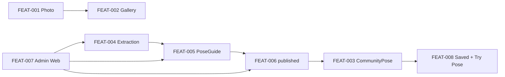

# Domain Model

Mô hình dữ liệu product mà [FEAT-001](../../harness/features/FEAT-001-capture-a-photo-on-mobile.md)–[FEAT-008](../../harness/features/FEAT-008-use-published-poses.md) yêu cầu.

## Hai layer, không đồng bộ

| Layer | Thực thể | Ý nghĩa |
|---|---|---|
| Mobile local | `Photo`, `PersonalPose` | Ảnh chụp và pose cá nhân sống trên thiết bị. Không có FK tới server. |
| Server | `PoseGuide`, `CommunityPose`, `MediaAsset`, `ExtractionJob`, `Account`, `SavedEntry`, `ApiKeyCredential`, `ProviderRequestLog` | Guide, catalog công khai, job, identity, saved collection, vận hành provider. |
| Mobile conceptual | `PoseReferenceKey`, `PreparedPoseReference` | Hợp đồng in-memory cho Try Pose. Không persist. |

Mobile không sở hữu `CommunityPose`. Server không sở hữu `Photo`.

## Aggregate trung tâm: PoseGuide

`PoseGuide` là đơn vị làm việc của Pose Guide Owner ([FEAT-005](../../harness/features/FEAT-005-manage-a-pose-guide.md)):

- metadata (tên, mô tả, tags, difficulty, body parts)
- owner (`Account`)
- media: source, render, thumbnail (`MediaAsset`)
- lịch sử extraction (`ExtractionJob`)
- visibility (`PoseStatus`: `draft` | `published`)

`CommunityPose` là **projection công khai** của một `PoseGuide` đã `published`. Cùng `id`. Public catalogue ([FEAT-003](../../harness/features/FEAT-003-browse-and-search-published-poses.md)) chỉ đọc projection này; không lộ owner, source asset, hay job.

Publication ([FEAT-006](../../harness/features/FEAT-006-publish-a-pose.md)) là chuyển visibility của `PoseGuide`, không tạo entity thứ hai.

## Luồng product

1. Photographer chụp `Photo` (FEAT-001) và quản lý gallery local (FEAT-002).
2. Một ảnh nguồn đi qua extraction (FEAT-004) để ra một render dùng lại được.
3. Pose Guide Owner gắn render đó vào `PoseGuide` (FEAT-005): metadata, retry, re-extract, revert, xóa.
4. Pose Owner publish khi guide đủ điều kiện: có `MediaAsset` render `ready` và đủ thẩm quyền (FEAT-006).
5. Visitor/user duyệt `CommunityPose` published, lọc, tìm theo title (FEAT-003).
6. Signed-in user lưu `SavedEntry` và chuẩn bị Try Pose (FEAT-008). Use không cấp quyền sở hữu.
7. Admin Web (FEAT-007) vận hành cùng các hợp đồng trên; không định nghĩa model extraction/guide/publication riêng.

## Ranh giới quan trọng

- `Photo` / `PersonalPose` không sync lên server.
- `published` chỉ hợp lệ khi render asset `ready` — không đồng nghĩa với “đã enqueue job”.
- `SavedEntry` theo dõi sử dụng cá nhân; unpublish/xóa guide phải ngừng trình bày pose đó như nội dung công khai.
- `ApiKeyCredential` / `ProviderRequestLog` là vận hành provider, không phải catalog product.
- `schema_bootstrap` (nếu có ở runtime) là operational, không thuộc domain product.
