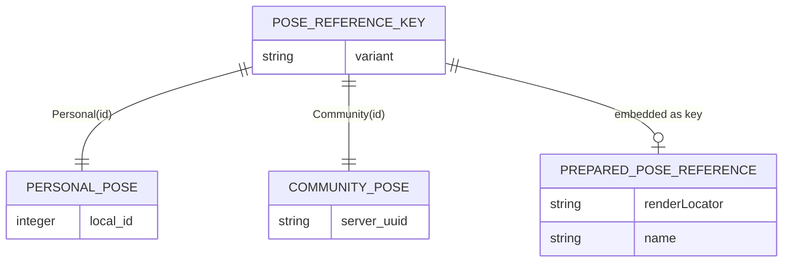
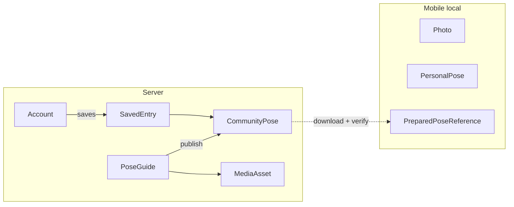

# ERD — Conceptual overlay

Quan hệ Try Pose và ranh giới mobile/server. [FEAT-008](../../../harness/features/FEAT-008-use-published-poses.md).

## Try Pose (in-memory)

`PreparedPoseReference.renderLocator` luôn local/data URI sau khi verify. Không persist relaunch.

## Ranh giới layer

Không có FK từ `Photo` / `PersonalPose` sang server. `SavedEntry` không cấp ownership `PoseGuide`.
