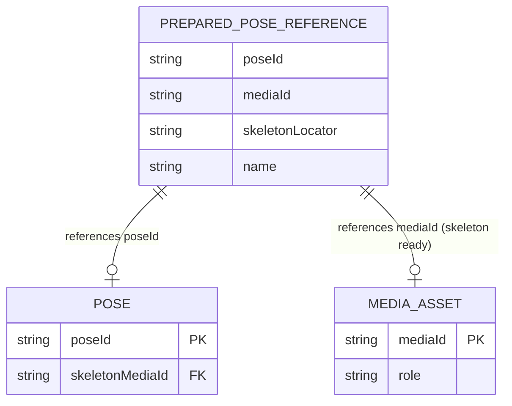
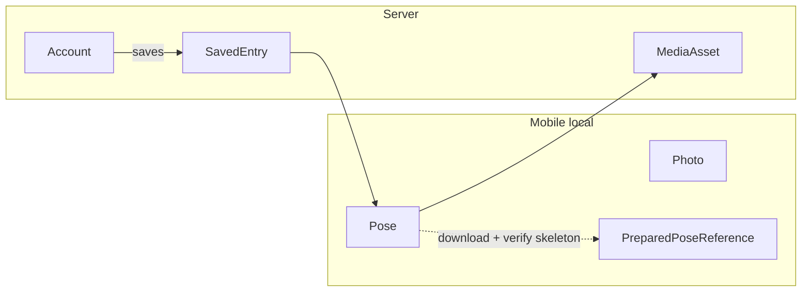

# ERD — Conceptual overlay

Quan hệ Try Pose và ranh giới mobile/server. [FEAT-008](../../../harness/features/FEAT-008-use-published-poses.md).

## Try Pose (in-memory)

`PreparedPoseReference.skeletonLocator` luôn local/data URI sau khi verify. Không
persist relaunch. Không còn `PoseReferenceKey.Personal|Community`.

## Ranh giới layer

Không có FK bắt buộc từ `Photo` sang server. `SavedEntry` không cấp ownership
`Pose`. Catalogue công khai là view/DTO — không phải entity riêng.