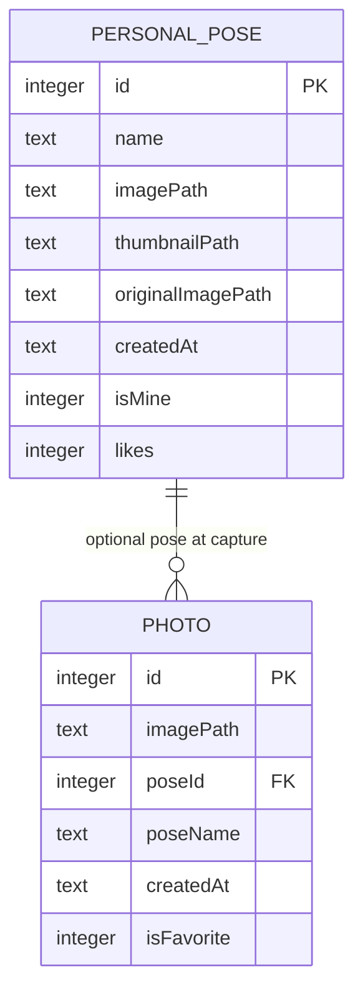

# ERD — Mobile local

Ảnh chụp và pose cá nhân trên thiết bị. [FEAT-001](../../../harness/features/FEAT-001-capture-a-photo-on-mobile.md), [FEAT-002](../../../harness/features/FEAT-002-manage-a-local-photo-gallery.md). Không FK tới server.

`Photo.poseId` → `PersonalPose.id` optional, ON DELETE SET NULL.
