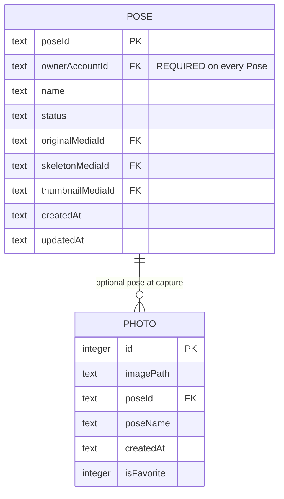

# ERD — Mobile local

Ảnh chụp và pose local trên thiết bị. [FEAT-001](../../../harness/features/FEAT-001-capture-a-photo-on-mobile.md),
[FEAT-002](../../../harness/features/FEAT-002-manage-a-local-photo-gallery.md).
`Pose` local dùng canonical entity với `status = local` và được tạo **sau khi
extraction `succeeded`** (không có pose persisted trước đó).

`Photo.poseId` → `Pose.poseId` optional (UUID), ON DELETE SET NULL — liên kết chỉ
tồn tại khi pose đã được tạo (post-extraction). Không còn
`PersonalPose` entity riêng; pose local dùng `Pose`. Cả ba slot media
(`originalMediaId`, `skeletonMediaId`, `thumbnailMediaId`) non-nullable tại lúc
tạo pose.