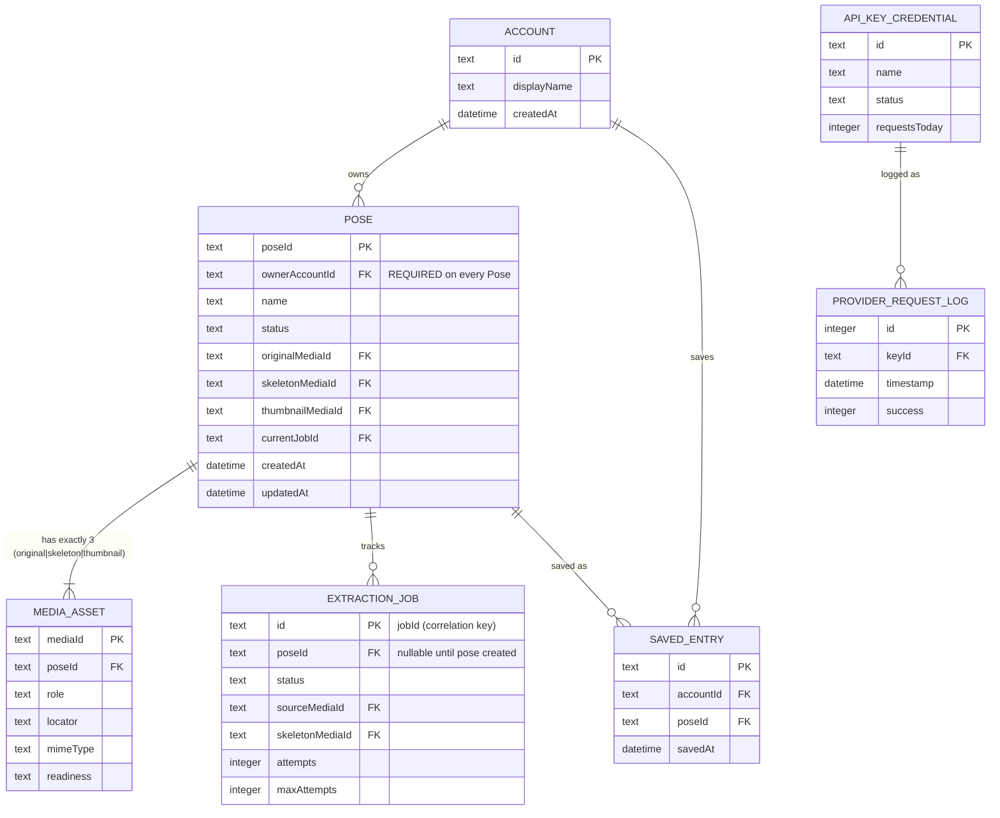

# ERD — Server

Hợp đồng quan hệ phía server theo [domain model](../domain-model.md). Entity
canonical duy nhất là `Pose`; catalogue công khai là view/DTO (`status=published`),
không phải entity riêng.

`Pose.status = published` chỉ có trên public view (DTO `CommunityPose`); public API
không trả owner, original, hay job. `poseId` ổn định từ `local` → `published` và
được gán tại lúc tạo — **`Pose` chỉ được tạo sau khi extraction `succeeded`**
(trong lúc extraction, job được theo dõi bằng `jobId`). `ownerAccountId` bắt buộc
(non-nullable) trên mọi `Pose`; `ExtractionJob.poseId` nullable tới khi pose tạo.
Xem glossary [`pose-domain-glossary.md`](../../../harness/specs/pose-domain-glossary.md).