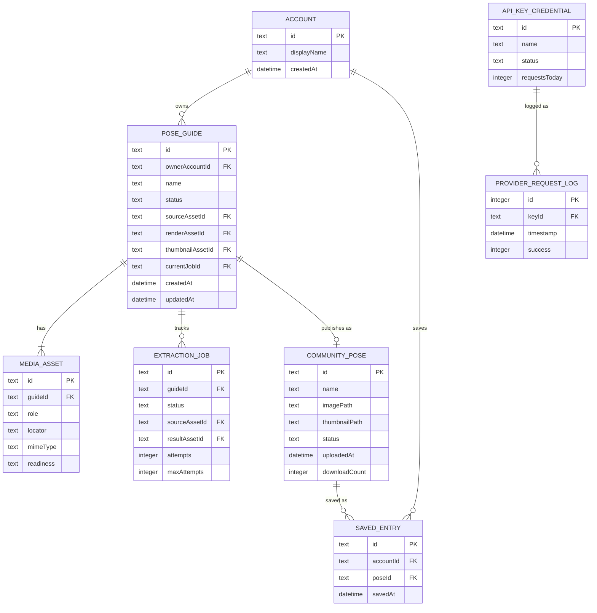

# ERD — Server

Hợp đồng quan hệ phía server theo [domain model](../domain-model.md).

`CommunityPose` là projection: cùng `id` với `PoseGuide` khi `status = published`. Public API không trả owner hay job.
