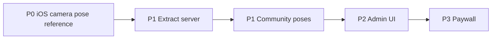

# Snap Pose — Roadmap 5 nhóm (lane BACKLOG)

Roadmap này bổ sung cho [`product-delivery-roadmap.md`](../../docs/harness/specs/product-delivery-roadmap.md) ở góc nhìn kỹ thuật/lane. Business phase vẫn do harness spec làm authority; file này gom 5 workstream và thứ tự ưu tiên cho executor BACKLOG.

## North Star (nhắc lại)

> User chọn pose → thấy pose trong Camera → chụp ảnh → xem kết quả.

Nguồn: `docs/harness/specs/product-delivery-roadmap.md`.

## Tóm tắt ưu tiên

| Priority | Nhóm | Trạng thái docs | Ghi chú |
| --- | --- | --- | --- |
| **P0** | iOS camera pose reference | Harness plan 2241 pending; backlog plan 260830-1327 | **Ưu tiên lane BACKLOG** — durable handoff, không bị block bởi COM/ADM |
| P1 | Extract server | REP-002 gaps; plan 260816-2240 | Hardening trước scale publish |
| P1 | Community poses | REP-005/010 delivered slice; dual-layer pending | Làm giàu catalogue sau EXT |
| P2 | Admin UI | TODO.md CRUD mở | Vận hành sau multipart baseline |
| P3 | Paywall / purchase | Plan 260826-0003 pending; FEAT-011 proposed | Sau MVP loop ổn định |

## Sequencing (thứ tự canonical lane)

**Thứ tự thực thi đề xuất:** CAM → EXT → COM → ADM → PAY

1. **iOS camera pose reference (CAM)** — durable relaunch handoff; dùng catalogue/pose local **đã có**.
2. **Extract server (EXT)** — worker↔R2, job atomicity trước scale community publishing.
3. **Community poses (COM)** — dual-layer, catalogue UX; tăng giá trị Try Pose.
4. **Admin UI (ADM)** — CRUD community, multipart intake.
5. **Paywall (PAY)** — sau MVP loop + Product Authority approve FEAT-011.

> **Chú thích:** CAM **không** phụ thuộc COM hay ADM để bắt đầu P0. Partial session overlay đã có evidence (`REP-006`); gap còn lại là durable persistence theo plan 2241. COM/ADM/EXT là workstream song song/sau CAM theo thứ tự canonical trên, không phải blocker P0 Camera.

Graph thể hiện **thứ tự ưu tiên lane** (CAM trước, PAY cuối), không khẳng định CAM phải chờ EXT/COM/ADM. Không có cạnh COM→CAM hay ADM→CAM (tránh mâu thuẫn với P0 độc lập).

## Chi tiết từng nhóm

### 1. iOS camera pose reference (P0 — selected)

**Mục tiêu:** Try Pose → promote `ActivePoseReference` durable → Camera overlay (giữ pan/zoom/opacity/toggle hiện hữu) → survive relaunch + clear lifecycle.

**Dependencies in (authority, không block cook P0 docs):**

- FEAT-003 library/detail slice (`REP-006` `E-TRY-EMIT`)
- Harness plan `260809-2241` + FEAT-008 relaunch acceptance

**Không phụ thuộc:** COM catalogue mới, ADM CRUD, EXT hardening — chỉ **làm giàu** trải nghiệm sau.

**Out of scope:** Paywall gates; Saved Poses server-side; skeleton joint editing.

**Execution plan:** [`../260830-1327-ios-camera-pose-reference/plan.md`](../260830-1327-ios-camera-pose-reference/plan.md)

**Harness authority:** [`docs/harness/plans/260809-2241-selected-pose-camera-handoff/plan.md`](../../docs/harness/plans/260809-2241-selected-pose-camera-handoff/plan.md)

---

### 2. Extract server (P1)

**Mục tiêu:** Async extraction reliable — job↔Pose↔`MediaAsset`↔R2, provider switch, concurrency safe.

**Dependencies:** `docs/spec/data/entities/extraction-job.md`; REP-002 GAP mitigation (baseline audit).

**Evidence:** `docs/harness/plans/260816-2240-higgsfield-cli-parallel-extract-provider/plan.md`

---

### 3. Community poses (P1)

**Mục tiêu:** Published catalogue ổn định, dual-layer preview, search/detail parity.

**Dependencies:** EXT upload pipeline; plan `260510-1726-dual-layer-pose-source-image` (pending).

**Evidence:** REP-005, REP-010

---

### 4. Admin UI (P2 ops)

**Mục tiêu:** Community poses CRUD, multipart intake, job status visibility.

**Dependencies:** EXT admin routes; plan `260505-0840-admin-community-multipart-sync-extract`; `TODO.md`.

**Evidence:** FEAT-007, `docs/spec/api/modules/admin-community.md`

---

### 5. Paywall / purchase (P3)

**Mục tiêu:** RevenueCat entitlement, paywall triggers — FEAT-011.

**Dependencies:** DEC-007/DEC-008; FEAT-011 approved; CAM MVP loop stable.

**Evidence:** `docs/harness/plans/260826-0003-integrate-revenuecat-paid-access-and-iap-for-feat-011/plan.md`

---

## Explicitly out of scope (toàn roadmap BACKLOG)

- Sửa source code, tests, CI trong lane docs-only tasks
- Android target
- Public UGC launch trước `docs/privacy-ugc-compliance.md` gates

## Gates (future execution handoff — không phải approval)

| Gate | Áp dụng cho |
| --- | --- |
| Harness plan approval (Repository Maintainer) | Cook harness track |
| REP-012 remediation accepted | Roadmap và backlog plans |
| Real-iPhone evidence (Mobile MCP) | Claim durable handoff complete |
| REP-002 extract gaps closed | Community publish at scale |
| FEAT-011 approved | Paywall work |

## Liên kết

- Survey: [`REP-012`](../../docs/harness/reports/REP-012-backlog-lane-documentation-survey.md)
- P0 plan: [`260830-1327-ios-camera-pose-reference/plan.md`](../260830-1327-ios-camera-pose-reference/plan.md)
