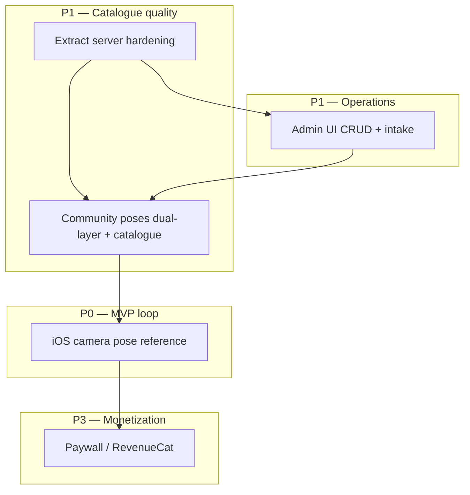

# Snap Pose — Roadmap 5 nhóm (lane BACKLOG)

Roadmap này bổ sung cho [`product-delivery-roadmap.md`](../docs/harness/specs/product-delivery-roadmap.md) ở góc nhìn kỹ thuật/lane. Business phase vẫn do harness spec làm authority; file này gom 5 workstream và thứ tự phụ thuộc cho executor BACKLOG.

## North Star (nhắc lại)

> User chọn pose → thấy pose trong Camera → chụp ảnh → xem kết quả.

Nguồn: `docs/harness/specs/product-delivery-roadmap.md`.

## Tóm tắt ưu tiên

| Priority | Nhóm | Trạng thái docs | Ghi chú |
| --- | --- | --- | --- |
| **P0** | iOS camera pose reference | Harness plan 2241 pending; backlog plan 260830-1327 | **Ưu tiên thực thi lane BACKLOG** |
| P1 | Community poses | REP-005/010 delivered slice; dual-layer pending | Phụ thuộc extract + admin intake ổn định |
| P1 | Extract server | REP-002 gaps; plan 260816-2240 | Blocker khi bật publish scale |
| P2 | Admin UI | TODO.md CRUD mở | Song song sau multipart baseline |
| P3 | Paywall / purchase | Plan 260826-0003 pending; FEAT-011 proposed | Sau MVP loop ổn định |

## Sequencing (dependencies)

### Thứ tự đề xuất

1. **iOS camera pose reference** — unblock North Star; dùng pose đã browse được (local + community).
2. **Extract server** — worker↔R2, job atomicity (REP-002) trước khi scale community publishing.
3. **Community poses** — dual-layer `source_image_path`, catalogue UX; tăng giá trị Try Pose.
4. **Admin UI** — CRUD community, multipart intake; vận hành nội dung.
5. **Paywall / purchase** — sau khi MVP loop và Product Authority approve FEAT-011.

## Chi tiết từng nhóm

### 1. iOS camera pose reference (P0 — selected)

**Mục tiêu:** Try Pose → persist active reference → Camera overlay (opacity/toggle/clear) → survive relaunch.

**Dependencies in:**

- FEAT-003 library/detail (delivered slice REP-006)
- Harness prerequisites: plans `260809-2240`, `260809-1806` (authority)

**Dependencies out:**

- Phase 2 business roadmap (Community → Camera)
- FEAT-008 Saved/Try Pose camera lifecycle

**Out of scope (roadmap này):**

- Paywall gates
- Saved Poses persistence server-side
- Skeleton joint editing

**Execution plan:** [`../260830-1327-ios-camera-pose-reference/plan.md`](../260830-1327-ios-camera-pose-reference/plan.md)

**Harness authority:** `docs/harness/plans/260809-2241-selected-pose-camera-handoff/plan.md`

---

### 2. Community poses (P1)

**Mục tiêu:** Published catalogue ổn định, dual-layer preview (source + skeleton), search/detail parity.

**Dependencies:**

- Extract server upload pipeline
- `docs/spec/api/modules/community.md` contract
- Plan `260510-1726-dual-layer-pose-source-image` (pending)

**Out of scope:**

- User publishing (FEAT-006) full lifecycle
- Albums / Saved (Phase 3–4 business roadmap)

**Evidence:** REP-005, REP-010, `plans/260510-1726-*`

---

### 3. Paywall / purchase (P3)

**Mục tiêu:** RevenueCat entitlement, paywall triggers, restore — FEAT-011.

**Dependencies:**

- DEC-007, DEC-008 resolved
- Product Authority approve FEAT-011
- MVP camera loop stable (tránh gate trước khi có giá trị core)

**Out of scope:**

- Firebase / Remote Config (FEAT-010 plan riêng)
- Web admin monetization

**Evidence:** `docs/harness/plans/260826-0003-integrate-revenuecat-paid-access-and-iap-for-feat-011/plan.md`

---

### 4. Admin UI (P1 ops)

**Mục tiêu:** Community poses CRUD, multipart intake, job status visibility.

**Dependencies:**

- Extract server admin routes
- Plan `260505-0840-admin-community-multipart-sync-extract`
- `TODO.md` checklist

**Out of scope:**

- Mobile admin
- Alternate extraction model (FEAT-007 boundary)

**Evidence:** FEAT-007, `docs/spec/api/modules/admin-community.md`

---

### 5. Extract server (P1 infra)

**Mục tiêu:** Async extraction reliable — job↔pose↔R2, provider switch, concurrency safe.

**Dependencies:**

- `docs/spec/data/entities/extraction-job.md`
- REP-002 GAP-001–007 mitigation

**Out of scope:**

- Mobile on-device extraction
- sub2api integration (README: untracked checkout)

**Evidence:** `docs/harness/plans/260816-2240-higgsfield-cli-parallel-extract-provider/plan.md`, `web/services/pose-extract-server/plans/`

---

## Explicitly out of scope (toàn roadmap BACKLOG)

- Sửa source code, tests, CI trong lane docs-only tasks
- Android target
- Public UGC launch trước `docs/privacy-ugc-compliance.md` gates
- Push/cherry-pick cross-branch

## Gates trước khi promote priority

| Gate | Áp dụng cho |
| --- | --- |
| Harness plan approval (Repository Maintainer) | Mọi cook từ harness plans |
| REP-012 survey accepted | Roadmap và backlog plans |
| Real-iPhone evidence (Mobile MCP) | iOS camera pose reference |
| REP-002 extract gaps closed | Community publish at scale |
| FEAT-011 approved | Paywall work |

## Liên kết

- Survey: [`REP-012`](../docs/harness/reports/REP-012-backlog-lane-documentation-survey.md)
- Design alignment: commit `docs(backlog): align prototype README tokens...`
- P0 plan: [`260830-1327-ios-camera-pose-reference/plan.md`](../260830-1327-ios-camera-pose-reference/plan.md)
