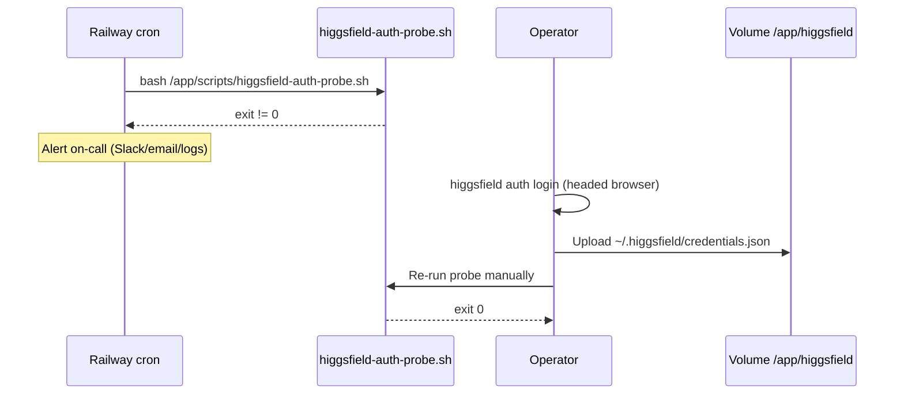

# S1 — Higgsfield auth health probe runbook

**Plan:** [260816-2240-higgsfield-cli-parallel-extract-provider](../../../docs/harness/plans/260816-2240-higgsfield-cli-parallel-extract-provider/plan.md)  
**Work Item:** WI-5  
**Owner:** Platform / on-call operator  
**Last verified CLI:** `@higgsfield/cli@1.1.23` (global `higgsfield` binary)

## Purpose

Production uses the **S1** path (design decision #8): a scheduled probe validates Higgsfield OAuth credentials mounted on Railway. When the probe fails, a human re-authenticates on a **headed** machine and uploads fresh `credentials.json` to the Railway volume. **Never** run `higgsfield auth login` inside headless Docker or on a cron schedule.

## Architecture

```text
pose-extract-server container (combined API + worker)
├── node dist/index.js
├── node dist/worker/worker-main.js
├── /app/data/                         # browser profile / local scratch (Railway volume: data; NOT the DB)
├── /app/higgsfield/                   # Railway volume: higgsfield
│   └── credentials.json               # HIGGSFIELD_CREDENTIALS_PATH
└── higgsfield                         # global npm bin (@higgsfield/cli)
```

| Variable | Value | Notes |
| --- | --- | --- |
| `HIGGSFIELD_CREDENTIALS_PATH` | `/app/higgsfield/credentials.json` | Set in `Dockerfile`; override only if mount path changes |
| Volume mount | `/app/higgsfield` → Railway volume `higgsfield` | Declared in repo root `railway.toml` |

## Probe script

**Path:** `web/services/pose-extract-server/scripts/higgsfield-auth-probe.sh`  
**npm:** `npm run probe:higgsfield-auth` (from `pose-extract-server` directory)

The probe runs:

1. `higgsfield auth token` — confirms a readable OAuth token from the credentials file  
2. `higgsfield account status` — confirms the token works against the Higgsfield API  

**Deviation from design sketch:** `@higgsfield/cli@1.1.23` does not implement `higgsfield auth status`. The probe uses `auth token` + `account status`, which are the supported equivalents.

Exit codes:

| Code | Meaning |
| --- | --- |
| `0` | Credentials valid; account reachable |
| `1` | Missing credentials file |
| `2+` | CLI-reported auth/API failure (e.g. expired token) |
| `127` | `higgsfield` not on PATH |

## Railway volume setup (one-time)

1. Open the **pose-extract-server** service in [Railway](https://railway.com).
2. **Volumes** → **Add volume** → name `higgsfield`, mount path **`/app/higgsfield`**.
   - Repo `railway.toml` already declares this mount; first deploy may prompt to create the volume.
3. Confirm env var **`HIGGSFIELD_CREDENTIALS_PATH=/app/higgsfield/credentials.json`** (set by Docker image; optional explicit service variable for documentation).
4. Do **not** store `credentials.json` in Railway **Variables** (size/rotation); use the volume file only.

### Initial credentials upload

After human login (see below):

```bash
# From operator machine with Railway CLI linked to the project
railway link   # if not already linked
railway shell --service <pose-extract-server-service>

# Inside the container shell (paths must match mount):
mkdir -p /app/higgsfield
# Paste/upload credentials.json content — example from local machine:
# railway run is NOT suitable for binary/json upload; prefer:
#   1) railway ssh + heredoc/editor, or
#   2) copy from headed login machine via scp/railway connect, or
#   3) one-time: cat > /app/higgsfield/credentials.json <<'EOF'
#      { ... redacted json ... }
#      EOF
chmod 600 /app/higgsfield/credentials.json
bash /app/scripts/higgsfield-auth-probe.sh
```

Alternatively, copy from the headed login machine:

```bash
# On headed machine after `higgsfield auth login`
scp ~/.higgsfield/credentials.json \
  railway:/app/higgsfield/credentials.json
# (Use your project's documented Railway file upload method if scp is unavailable.)
```

## Railway cron (recommended: every 6 hours)

Configure a **Cron Schedule** on the same `pose-extract-server` service (or a dedicated cron service using the same image + volume).

### Dashboard steps

1. Service → **Settings** → **Cron Schedule** (or **Deploy** → cron trigger, depending on Railway UI version).
2. Schedule: `0 */6 * * *` (every 6 hours UTC).
3. **Start command** (one-shot; must exit when probe finishes):

```bash
bash /app/scripts/higgsfield-auth-probe.sh
```

4. Ensure the cron job uses the **same** `/app/higgsfield` volume mount as the main service so it reads the same `credentials.json`.
5. Wire Railway **Observability → Notifications** (Slack/email) on deploy/cron failure, or monitor non-zero exit in logs.

### Example service fragment (redacted)

```json
{
  "service": "pose-extract-server",
  "mounts": [
    { "source": "data", "destination": "/app/data" },
    { "source": "higgsfield", "destination": "/app/higgsfield" }
  ],
  "variables": {
    "HIGGSFIELD_CREDENTIALS_PATH": "/app/higgsfield/credentials.json",
    "DATABASE_URL": "[REDACTED]",
    "ADMIN_SECRET": "[REDACTED]"
  },
  "cron": {
    "schedule": "0 */6 * * *",
    "command": "bash /app/scripts/higgsfield-auth-probe.sh"
  }
}
```

> **Screenshot:** Capture Railway cron + volume settings in the dashboard when deploying; store in internal ops wiki. This runbook documents the target config when a screenshot is not attached to the repo.

## Alert → human recovery (S1)



### Step-by-step

1. **Alert:** Cron or monitoring reports probe failure (exit non-zero) or log lines `ERROR:` / `Not authenticated`.
2. **Acknowledge:** Pause switching admin provider to `higgsfield_cli` if jobs are failing with `PROVIDER_AUTH_REQUIRED`.
3. **Re-login (headed only):**
   ```bash
   npm install -g @higgsfield/cli@1.1.23   # or use existing install
   higgsfield auth login                    # opens browser; complete OAuth
   ls -la ~/.higgsfield/credentials.json
   ```
   **Forbidden:** `higgsfield auth login` inside Docker, Railway cron, CI, or any headless environment.
4. **Upload:** Copy the new `credentials.json` to Railway volume path `/app/higgsfield/credentials.json` (see [Initial credentials upload](#initial-credentials-upload)).
5. **Verify:**
   ```bash
   railway shell --service <pose-extract-server>
   bash /app/scripts/higgsfield-auth-probe.sh
   echo $?   # must be 0
   ```
6. **Resume:** Confirm next scheduled cron succeeds; re-enable `higgsfield_cli` if it was paused.

## WI-7 verification drills (2026-08-17)

### Failure drill (invalid credentials path)

```text
$ cd web/services/pose-extract-server
$ HIGGSFIELD_CREDENTIALS_PATH=/tmp/no-credentials-wi7.json npm run probe:higgsfield-auth
ERROR: credentials file missing at /tmp/no-credentials-wi7.json
$ echo $?
1
```

**Result:** Probe exits `1` with actionable `ERROR:` line — matches S1 alert path in runbook.

### Valid-credentials drill

**Status:** Not executed in CI (no staging `credentials.json` in repo or agent environment).

**Operator path:** On a headed machine with valid OAuth:

```bash
HIGGSFIELD_CREDENTIALS_PATH="$HOME/.higgsfield/credentials.json" npm run probe:higgsfield-auth
# Expected: exit 0; "Probe: auth token OK"; account status (redact PII in logs)
```

**Gap for Lead:** Production/staging valid-credentials drill requires operator-owned `credentials.json` on Railway volume `/app/higgsfield/` — not available to automated WI-7 worker. Invalid drill + automated tests satisfy WI-7 S1 evidence gate per design (S1 human re-login runbook already in WI-5).

## Local / staging drills

```bash
cd web/services/pose-extract-server

# Invalid (missing file)
HIGGSFIELD_CREDENTIALS_PATH=/tmp/no-credentials.json npm run probe:higgsfield-auth
# Expected: exit 1, "credentials file missing"

# Invalid (empty dir, no file)
mkdir -p /tmp/higgsfield-empty
HIGGSFIELD_CREDENTIALS_PATH=/tmp/higgsfield-empty/credentials.json npm run probe:higgsfield-auth
# Expected: exit 1

# Valid: requires real credentials.json on operator machine
HIGGSFIELD_CREDENTIALS_PATH="$HOME/.higgsfield/credentials.json" npm run probe:higgsfield-auth
# Expected: exit 0, account status printed (redact email/plan in logs)
```

## Container boot verification

The main service **CMD** is unchanged: API and worker start in parallel:

```dockerfile
CMD ["bash", "-c", "node dist/index.js & node dist/worker/worker-main.js & wait -n"]
```

After image build, confirm CLI presence:

```bash
docker build -f web/services/pose-extract-server/Dockerfile -t pose-extract-server:wi5 .
docker run --rm pose-extract-server:wi5 higgsfield --version
docker run --rm pose-extract-server:wi5 test -x /app/scripts/higgsfield-auth-probe.sh
```

Full stack check: `npm run spike:docker-viability` (health endpoint against `DATABASE_URL`).

## Related

- Implementation design: [design.md](../../../docs/harness/plans/260816-2240-higgsfield-cli-parallel-extract-provider/design.md) — S1 decision #8, Docker/Railway layout  
- Provider reads `HIGGSFIELD_CREDENTIALS_PATH` in `HiggsfieldCliProvider`  
- Verification ledger: WI-7 (automated tests + production drill)
